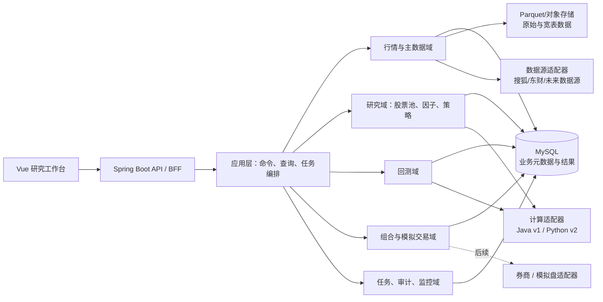
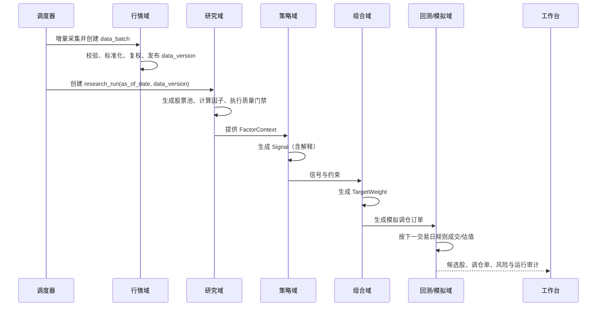

# 个人量化系统架构重构设计

> **项目**：quant-trading-system（以下简称 QuantTrade）  
> **版本**：v1.0（重构基线）  
> **日期**：2026-07-30  
> **范围**：A 股日频研究、选股、回测、模拟交易；实盘交易只定义边界，不在本次重构直接接入。

## 1. 背景与结论

QuantTrade 已具备 A 股历史行情采集、行情浏览、若干策略/打分、评分回测、经典策略回测和模拟账户能力。现有问题并非缺少功能，而是功能按页面和历史迭代堆叠，导致数据、评分逻辑和运行任务相互耦合：

- Java 中并存趋势、综合三维度、多维度、超跌反弹、统一评分等多条评分链路；其中 `UnifiedScoringService` 已超过 1,100 行，既做编排、取数、评分、持久化，又承担进度控制。
- 相近指标、权重和评分规则在多个服务中重复；同一字段可被写入不同含义的数据，结果难以追溯、比较和复现。
- `compute-python` 有策略和指标实现，但没有成为 Java 主流程可调用、可版本化的计算运行时，形成两套事实来源。
- 原始行情、复权行情、指标、因子、策略信号和回测结果的层次不明确；JPA 自动建表与手工 SQL 初始化脚本并存，演进风险较高。
- 回测与选股结果缺少统一的“运行快照”：无法严谨回答“某一日为何选出这只股票、当时使用了什么数据与参数”。

本设计采用 **模块化单体（modular monolith）+ 可替换计算适配器**。保留 Vue + Spring Boot + MySQL 的主技术栈，先把领域边界、数据契约和任务模型稳定下来；只有出现明确的吞吐量或部署隔离需求时，才把计算运行时拆为独立 Python 服务。不要在此阶段拆微服务。

## 2. 目标、范围与非目标

### 2.1 重构目标

1. 一条可复现的研究链路：数据版本 → 股票池 → 因子/信号 → 组合 → 回测/报告。
2. 每一个策略只负责生成信号，不直接操作数据库、HTTP、线程或页面 DTO。
3. 每一种因子、策略、股票池、回测配置和运行结果都具备唯一版本与审计信息。
4. 为 A 股日频研究提供可信的交易约束：T+1、涨跌停、停牌、最小交易单位、手续费及印花税。
5. 保留现有的历史数据采集与打分能力，通过适配层逐步迁移，不做一次性推倒重写。

### 2.2 本期范围

- A 股、日线、EOD（收盘后）选股与下一交易日成交假设。
- 历史数据补齐、数据质量校验、复权、股票池、因子研究、评分策略、组合构建、回测、模拟调仓和报告。
- 前端作为研究工作台：任务、结果、因子解释、回测、模拟组合、数据质量。

### 2.3 非目标

- 高频、盘口级低延迟交易。
- 自动实盘下单；该能力须在模拟盘稳定后另立设计，且需券商 API、密钥托管、人工确认、熔断和合规评审。
- 用机器学习替代基础数据治理与样本外验证。

## 3. 架构原则

| 原则 | 约束 |
|---|---|
| 单一事实来源 | 行情、复权、因子、信号、订单和成交各自只有一个权威模型与写入入口。 |
| 研究可复现 | 所有运行固定 `as_of_date`、数据版本、代码版本、配置版本、随机种子和成本模型版本。 |
| 策略无基础设施依赖 | 策略只能依赖领域输入与接口，不能直接使用 Repository、Controller、线程池或 HTTP 客户端。 |
| 读写分离 | 写入使用命令/任务；页面查询走只读 Query Service，不复用复杂领域服务。 |
| 显式交易假设 | 所有回测必须记录成交价、滑点、费用、涨跌停、停牌、T+1 等规则版本。 |
| 先验证、后自动化 | 研究结果先经过样本外、滚动回测和模拟调仓，才可进入交易执行边界。 |

## 4. 目标总体架构



### 4.1 分层规则

```text
interfaces（Controller、任务入口、外部适配器）
        ↓
application（用例编排、事务、权限、任务状态）
        ↓
domain（股票池、因子、策略、回测、组合、风控规则）
        ↓
infrastructure（JPA、数据源 HTTP、文件、消息、缓存）
```

- `domain` 不可 import Spring、JPA、Web、JSON 或具体数据源 SDK。
- `application` 可依赖 domain 的端口（接口），不可直接依赖外部数据源的具体实现。
- `infrastructure` 实现端口；不同数据源、Java/Python 计算器、未来券商都在这一层替换。
- Controller 只做参数校验、鉴权和 DTO 转换，禁止计算指标、拼装 SQL 或启动异步线程。

## 5. 领域模块与职责

| 模块 | 职责 | 本期核心能力 | 不能负责的事 |
|---|---|---|---|
| `market-data` | 主数据、交易日历、行情采集、复权、质量 | 数据补齐、幂等入库、异常检测、数据版本 | 打分、选股、回测决策 |
| `research` | 股票池、因子定义与计算、因子检验 | 过滤、截面标准化、中性化、IC/分层收益 | 下单与账户更新 |
| `strategy` | 将研究结果转换为目标信号 | 趋势、反转、多因子策略；参数与版本 | 直接读写数据库、直接调用数据源 |
| `portfolio` | 信号到目标权重 | Top-N、等权、行业/单票约束、换手约束 | 计算技术指标 |
| `backtest` | 历史仿真与绩效归因 | 交易规则、成本、权益曲线、滚动验证 | 复用页面展示模型 |
| `paper-trading` | 模拟账户、订单、成交、对账 | 目标仓位转模拟订单、日终估值 | 实盘券商耦合 |
| `operations` | 异步任务、审计、告警、配置发布 | 幂等、断点续跑、日志、运行快照 | 业务算法 |
| `reporting` | 面向 UI 的只读视图与日报 | 选股解释、策略对比、风险提示 | 修改领域状态 |

### 5.1 策略与因子的边界

**因子**是可复用、可检验的数值特征，例如 20 日动量、ROE、换手率分位数、波动率；输出为每个标的在指定日期的值与质量标记。

**策略**是组合因子、市场状态和过滤规则后产生投资观点的规则；输出为 `Signal`，不得输出“买入订单”。

**组合构建**将信号转为目标权重；**执行/模拟交易**才将目标权重转为订单。四层不允许合并。

```text
FactorValue -> StrategySignal -> TargetWeight -> OrderIntent -> Fill
```

## 6. 核心领域契约

以下是重构时应优先固定的对象，不要求首期一次性实现全部字段。

```java
public record MarketBar(
    InstrumentId instrument, LocalDate tradeDate,
    BigDecimal open, BigDecimal high, BigDecimal low, BigDecimal close,
    Long volume, BigDecimal amount, BigDecimal turnoverRate,
    AdjustmentType adjustment, String dataVersion) {}

public record FactorValue(
    FactorKey factor, InstrumentId instrument, LocalDate asOfDate,
    BigDecimal value, BigDecimal normalizedValue,
    QualityFlag quality, String factorVersion, String dataVersion) {}

public record Signal(
    StrategyKey strategy, InstrumentId instrument, LocalDate asOfDate,
    SignalDirection direction, BigDecimal score, BigDecimal confidence,
    Map<String, BigDecimal> exposures, String strategyVersion) {}

public record TargetWeight(
    PortfolioId portfolio, InstrumentId instrument, LocalDate asOfDate,
    BigDecimal targetWeight, List<ConstraintResult> constraints) {}
```

建议端口如下：

```java
interface MarketDataPort { List<MarketBar> bars(BarQuery query); }
interface FactorCalculator { FactorDefinition definition(); List<FactorValue> calculate(FactorContext context); }
interface Strategy { StrategyDefinition definition(); List<Signal> generate(StrategyContext context); }
interface PortfolioConstructor { List<TargetWeight> construct(PortfolioContext context, List<Signal> signals); }
interface BacktestEngine { BacktestResult run(BacktestRequest request); }
interface BrokerPort { List<Order> submit(List<OrderIntent> intents); } // v2 以后启用
```

策略定义、因子定义和回测配置必须是不可变 JSON/YAML 快照，并带有 `key + semanticVersion + contentHash`。修改参数不覆盖历史配置，而是产生新版本。

## 7. 数据架构

### 7.1 数据分层

| 层 | 内容 | 存储建议 | 写入原则 |
|---|---|---|---|
| Raw | 从数据源取得的原始响应 | 对象存储/本地文件，按来源和日期分区 | 只追加，不修改 |
| Normalized | 规范化日线、证券主数据、交易日历、财务快照 | MySQL（初期）+ Parquet（批量分析） | 幂等 upsert，保留来源与抓取批次 |
| Derived | 复权价、技术指标、因子值、行业中性化结果 | Parquet 宽表或独立因子表 | 由数据版本派生，不手工改值 |
| Research Result | 股票池、信号、目标权重、因子检验 | MySQL | 必须关联运行快照 |
| Trading Ledger | 模拟订单、成交、持仓、资产快照 | MySQL | 账本追加；状态转换受控 |

### 7.2 必须新增或演进的逻辑表

不要再以 `StockTrendScore` 兼容所有策略结果。建议新建以下清晰模型，并用 Flyway/Liquibase 迁移：

| 表/聚合 | 关键字段 | 用途 |
|---|---|---|
| `data_batch` | source、dataset、as_of_date、checksum、status | 每次采集的批次与质量结果 |
| `market_bar` | instrument_id、trade_date、adjustment_type、OHLCV、data_batch_id | 唯一的规范化行情事实表 |
| `corporate_action` | instrument_id、ex_date、action_type、ratio/cash | 复权及事件处理依据 |
| `factor_definition` / `factor_version` | key、版本、公式、参数、hash | 因子定义与发布历史 |
| `factor_value` | factor_version_id、instrument_id、as_of_date、raw/normalized 值、quality | 因子数值事实表 |
| `universe_definition` / `universe_member` | 条件版本、日期、标的、排除原因 | 可复现股票池 |
| `strategy_definition` / `strategy_version` | 策略参数、依赖因子、代码版本、hash | 策略注册与版本化 |
| `research_run` | run_type、as_of_date、配置快照、数据版本、状态 | 统一运行根对象 |
| `signal` | research_run_id、strategy_version、标的、分数、解释 JSON | 选股结果，不复用旧评分表 |
| `portfolio_target` | research_run_id、组合、标的、目标权重、约束结果 | 调仓建议 |
| `backtest_run` / `backtest_metric` / `backtest_fill` | 配置快照、指标、成交明细 | 完整回测审计 |
| `paper_order` / `paper_fill` / `position_lot` / `nav_snapshot` | 订单、成交、持仓批次、净值 | 模拟账户账本 |

### 7.3 数据质量门禁

在任何因子、策略和回测之前运行质量门禁；不合格时任务失败或降级，不能静默使用。

- 唯一性：`instrument + trade_date + adjustment_type` 不重复。
- 完整性：交易日应有预期覆盖率；停牌须显式标记，不可与缺失混同。
- 合法性：`low <= open/close <= high`，成交量和金额非负。
- 时序性：不允许未来日期、乱序、复权因子缺口。
- 可用性：因子窗口不足、财报过期、行业缺失应产生 `QualityFlag`，不伪造为 0。

## 8. 关键业务流程

### 8.1 日终研究与模拟调仓



### 8.2 回测必须遵守的时间规则

1. `T` 日收盘后只能使用在 `T` 日收盘时已知的数据；财报以公告可得日而非报告期入库。
2. `T` 日产生信号，默认在 `T+1` 开盘或 VWAP 成交；成交模型必须在配置中选择并记录。
3. 无法成交的涨停买入、跌停卖出、停牌和流动性不足订单应保持待成交/取消，不能假定成交。
4. 卖出遵守 A 股 T+1 可卖限制；最小交易单位为 100 股（除清仓等明确例外）。
5. 费用模型、滑点模型、基准、调仓频率和股票池都属于回测配置快照。

## 9. 代码与部署结构

建议先在 `modules/backend-java` 中按业务包实施模块化单体。不要继续以 `controller/service/repository/entity` 作为全部业务组织方式。

```text
modules/backend-java/src/main/java/com/quant/
├── shared/                         # ID、时间、错误、审计等小型共享内核
├── marketdata/
│   ├── domain/                     # MarketBar、CorporateAction、交易日历
│   ├── application/                # 采集、补齐、质量检查用例
│   ├── infrastructure/             # 搜狐/东财客户端、JPA、文件存储
│   └── interfaces/                 # DataController
├── research/
│   ├── domain/                     # Universe、Factor、FactorValue
│   ├── application/                # 因子计算、IC 检验、研究运行
│   └── interfaces/
├── strategy/
│   ├── domain/                     # Signal、Strategy、策略实现
│   ├── application/                # 策略运行与结果解释
│   └── infrastructure/             # 策略注册表、计算器适配器
├── portfolio/
├── backtest/
├── papertrading/
├── operations/                     # Task、Audit、Scheduler、Notification
└── reporting/                      # 只读投影与面向页面的查询

modules/compute-python/
├── quant_compute/                  # 只放批量计算/实验性因子，不放第二套业务编排
│   ├── indicators/
│   ├── factors/
│   ├── strategies/
│   └── contract/                   # 与 Java 共享的 JSON Schema/测试样例
└── tests/
```

### 9.1 Java 与 Python 的治理

- **v1**：日频核心因子、策略和回测统一在 Java 中执行；Python 仅用于离线研究和验证，输出标准 Parquet/JSON，不直接写生产业务表。
- **v2**：若因子计算确实需要 pandas/NumPy 生态，将 Python 封装为 `ComputePort` 的 HTTP/队列任务适配器；输入、输出均使用版本化 Schema。
- 同一策略不能在 Java 和 Python 各维护一份“看起来相近”的逻辑。若双实现用于校验，必须以固定样本建立契约测试并指定权威实现。

### 9.2 前端边界

前端按用户目标重组，而非按后端历史接口堆页面：

```text
数据中心：数据批次、覆盖率、质量异常
研究工作台：股票池、因子、策略版本、单次研究运行
回测中心：运行配置、权益曲线、成交、归因、滚动验证
模拟组合：目标权重、订单、持仓、净值、对账
运维中心：任务、失败重试、审计与告警
```

统一 TypeScript；删除重复入口、重复 store 和重复 API client。页面只调用 query/command API，不在浏览器重复计算评分。

## 10. API 与任务模型

### 10.1 命令接口

```text
POST /api/data-batches                 创建采集/补齐任务
POST /api/research-runs                创建选股研究运行
POST /api/backtest-runs                创建回测运行
POST /api/paper-portfolios/{id}/rebalance  由已批准目标权重创建模拟调仓
POST /api/tasks/{id}/cancel            取消可取消任务
```

命令接口返回 `202 Accepted + taskId/runId`，不在 HTTP 请求线程里计算全市场因子或回测。

### 10.2 查询接口

```text
GET /api/research-runs/{id}
GET /api/research-runs/{id}/signals?sort=score,desc
GET /api/research-runs/{id}/explanations/{instrument}
GET /api/backtest-runs/{id}/metrics
GET /api/backtest-runs/{id}/fills
GET /api/data-quality/latest
```

`Signal` 的解释至少包含：使用的策略版本、因子原值、标准化值、过滤/排除原因、约束造成的权重变化和数据质量标记。

### 10.3 统一任务状态机

```text
PENDING -> RUNNING -> SUCCEEDED
                  -> FAILED
                  -> CANCEL_REQUESTED -> CANCELLED
```

每个任务携带幂等键、输入快照、进度、可恢复检查点、错误分类和关联 `research_run/backtest_run`。现有异步评分任务、历史更新任务应迁入此模型，而非各自定义状态字段。

## 11. 风控、权限与可观测性

### 11.1 研究与交易风控

- 股票池过滤：ST、退市整理、停牌、上市天数不足、流动性不足、价格异常。
- 组合约束：单票、行业、风格暴露、总仓位、最大换手率、现金下限。
- 模拟交易约束：价格上下限、可用现金、可卖数量、最小手数、订单重复提交。
- 熔断：数据质量红灯、回撤/单日亏损阈值、连续任务失败时禁止自动调仓。

### 11.2 安全基线

- 生产环境强制开启鉴权；只开放登录/健康检查，其他 API 默认鉴权。
- 初始管理员密码、数据库密码、JWT 密钥和数据源凭证均从环境变量/密钥管理读取；不得提交到配置文件。
- 使用 Flyway/Liquibase 管理数据库迁移，禁止生产环境 `ddl-auto=update`。
- 审计“谁在何时以何配置运行/批准/取消了何任务”，模拟交易与未来实盘交易不可篡改。

### 11.3 可观测性

最小指标：数据延迟、覆盖率、质量失败数、任务耗时/成功率、因子计算耗时、回测耗时、策略候选数、组合换手、模拟组合净值与回撤。日志须携带 `taskId`、`runId`、`dataVersion`、`strategyVersion`。

## 12. 现有能力映射与处置

| 现有能力 | 目标模块 | 处置 |
|---|---|---|
| `HistoricalDataService`、`HistoricalDataUpdateService`、`RealtimeQuoteService` | `marketdata` | 保留采集实现，改为数据源适配器；统一通过 `data_batch` 发布。 |
| `MarketData`、`MarketPriceRaw`、复权因子 | `marketdata` | 明确 raw/normalized/adjusted 三层；不让策略直接读取 raw。 |
| `TechnicalIndicators`、`ScoringUtils` | `research` | 仅保留为指标/因子计算库；拆小、测试化，消除业务建议逻辑。 |
| `StockTrendScoringService`、`ComprehensiveScoringService`、`MultiDimScoringService` | `strategy` | 逐个迁为独立 `Strategy`；停止共享旧结果实体。 |
| `UnifiedScoringService` | `application + operations` | 拆为运行编排、股票池、因子计算、策略、持久化和进度六个用例；不再承载公式。 |
| `OversoldReboundScoringService` + Python scorer | `strategy` | 明确唯一权威实现；另一份仅作为契约测试对照，随后删除或封装。 |
| `ScoringBacktestService`、`StrategyBacktestService` | `backtest` | 合并至统一回测引擎，差异以 `Strategy/SignalSource` 配置表达。 |
| `SimAccountService`、订单/持仓 Controller | `papertrading` | 改为账本式订单、成交、持仓批次和净值快照。 |
| `FactorResearchService`、`WalkForwardService` | `research/backtest` | 作为因子检验、滚动验证用例，不与 UI DTO 耦合。 |

## 13. 分阶段迁移计划

### 阶段 0：冻结与基线（1 周）

1. 不新增评分策略和页面功能；为现有主要 API 建立冒烟测试。
2. 固化 3 个典型样本区间、股票池、评分结果和回测结果作为回归基线。
3. 清点所有评分入口与表写入点；列出废弃候选，禁止继续扩散。
4. 将配置中的密钥移至环境变量；生产禁用 `ddl-auto=update`。

**验收**：现有功能可运行；每一个评分入口能定位到实现类、输入数据和结果表。

### 阶段 1：数据与任务底座（1–2 周）

1. 引入 Flyway/Liquibase，建立 `data_batch`、`research_run`、通用 `task`。
2. 采集链路写入原始批次、规范化行情和质量报告；建立数据版本。
3. 将历史更新和统一评分的异步任务迁入统一状态机。

**验收**：任意研究运行可定位其数据批次；失败任务可看到错误和检查点，不产生半成品“最新结果”。

### 阶段 2：因子与策略拆分（2–3 周）

1. 先提取指标计算、股票池、因子计算、标准化/中性化接口，并补单元测试。
2. 选一个主策略（建议当前短周期评分）重写为 `Universe + Factors + Strategy`。
3. 结果写入新 `signal` 表；前端新建研究运行页，旧评分页只读兼容。

**验收**：同一输入快照重复运行结果一致；结果页面可解释每只股票的入选和排除原因。

### 阶段 3：统一回测与组合构建（2–3 周）

1. 将评分回测、经典策略回测统一为 `Signal → TargetWeight → Fill → NAV`。
2. 显式实现 A 股交易规则和成本模型；补充边界测试。
3. 增加基准、样本外区间、滚动/Walk-forward 验证和成交明细。

**验收**：回测的每笔交易均可从信号和成交规则复算；无法成交的订单不会被错误计入收益。

### 阶段 4：模拟交易与旧代码下线（1–2 周）

1. 由目标权重生成模拟调仓单，接入日终估值与对账。
2. 将旧接口标记 `deprecated`，迁移前端后删除旧评分结果表的写入逻辑。
3. 对 Python 计算模块作去留决策：删除重复实现，或按 `ComputePort` 纳入。

**验收**：只存在一个主评分运行入口和一个主回测入口；模拟组合可由同一策略配置驱动。

## 14. 测试与验收标准

| 类型 | 最低要求 |
|---|---|
| 单元测试 | 指标、因子、股票池、策略、费用、涨跌停、T+1、组合约束必须覆盖正常与边界案例。 |
| 契约测试 | 数据源适配器、Java/Python 计算器、前后端 API Schema。 |
| 回归测试 | 固定小样本数据集；同一代码/配置/数据版本应得到相同信号、成交与指标。 |
| 数据测试 | 日线唯一性、OHLC 合法性、交易日覆盖、复权连续性。 |
| 集成测试 | 从数据批次到研究运行、回测、报告的完整链路。 |
| 性能测试 | 全 A 股日频一次研究运行的耗时、内存和失败恢复能力。 |

## 15. 首个重构切片（建议立即实施）

不要先搬目录。选择“短周期评分选股”作为垂直切片，按以下顺序落地：

1. 定义 `ResearchRun`、`Universe`、`FactorValue`、`Signal` 四个模型及迁移表。
2. 从现有 `UnifiedScoringService` 中抽出只读数据加载器与 3–5 个基础因子。
3. 新建 `ShortHorizonStrategy`，只消费 `FactorContext`，输出 `Signal` 和解释。
4. 用固定日期与股票池与旧系统比对；差异必须逐条解释，不能以“结果更好”替代验证。
5. 前端新增“研究运行详情”页，展示运行快照、候选结果和因子贡献；旧页面暂保留。

完成这个切片后，再迁移其他策略。这样可以在不丢失现有数据采集能力的前提下，建立后续所有功能共同遵守的边界。

## 16. 待确认的产品决策

以下问题不阻塞阶段 0–2，但会影响后续成本模型和接口设计：

1. 系统第一目标是否固定为 A 股日频/隔日持有，还是要支持盘中分钟级？
2. 默认交付是“候选股和调仓建议”，还是“自动模拟下单”？
3. 历史行情、财务数据、公司行动、行业分类分别使用哪些可商用且可追溯的数据源？
4. 策略参数是代码发布管理，还是允许工作台配置发布？建议首期只允许受控配置，不支持页面编写任意公式。

