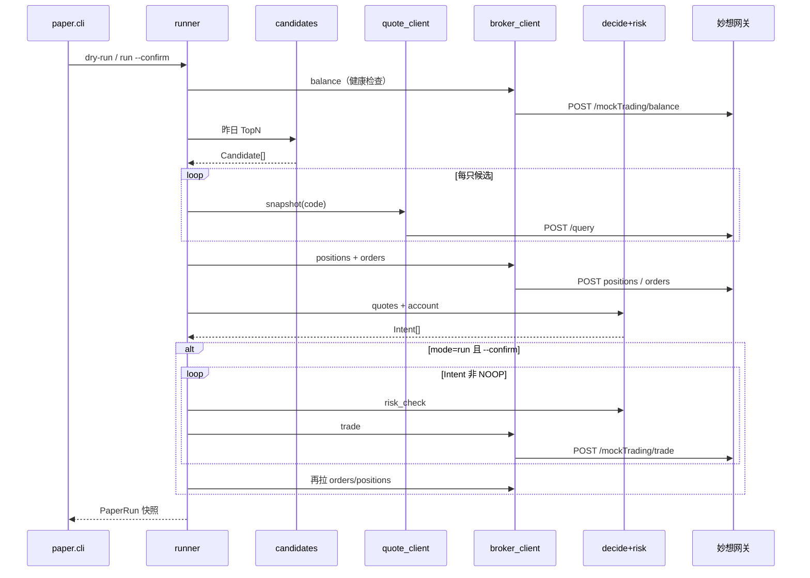

# 东方财富妙想模拟盘：行情查询、研判与模拟下单开发文档

> 项目：`quant-trading-system`  
> 版本：v1.1  
> 日期：2026-08-18  
> 状态：设计稿（接口依据本机 `mx_moni.py` / `mx_data.py`、Aniu `MXClient` 与妙想 Skills；账户绑定后须用真实 JSON 冻结 parser）  
> 范围：只用东方财富妙想 API 完成「查行情 → 本地研判 → 模拟下单 → 对账」。不接实盘、不接同花顺客户端、不接 QMT。

---

## 1. 结论先说

本项目已有日频选股和内部 `SimAccount`（历史时钟回放）。要试验「这一刻能不能成交」，应新增一条 **Paper Live** 链路，而不是改选股公式。

| 环节 | 用哪个妙想接口 | 谁做判断 |
|------|----------------|----------|
| 查最新价/涨跌幅 | `POST /api/claw/query` | 只取数 |
| 查资金/持仓/委托 | `/api/claw/mockTrading/{balance,positions,orders}` | 只取数 |
| 买/卖/撤 | `/api/claw/mockTrading/{trade,cancel}` | **禁止**让接口「决定买不买」 |
| 研判 | 无 | 本地规则：昨日 T+1 候选 + 实时可交易性 + 风控闸 |

本机 2026-08-18 实测：`MX_APIKEY` 可访问网关，`mockTrading/balance` 返回 **404「请先绑定账户」**。开发第一步是绑定模拟组合。

妙想行情是 **问句查数**，不是 Tick 推送。合理频率：开盘一次决策 + 观察池少量补查。禁止全市场轮询。

选股主航道（`docs/选股迭代优先方向.md` 的 A 类）不因本线停摆。Paper Live 属于 D 类扩展：先 Python CLI，Java 选股服务不直接打交易 API。

---

## 2. 目标、范围与非目标

### 2.1 目标与验收

| 编号 | 目标 | 验收 |
|------|------|------|
| G1 | 查询模拟账户资金、持仓、委托 | CLI 打印；原始 JSON 落盘 |
| G2 | 限价/市价买入、卖出、撤单 | 返回 `orderId`，随后 `orders` 能查到 |
| G3 | 决策前取候选股快照 | 解析出 `last / pct_chg / volume`，失败则该票不下单 |
| G4 | 昨日 T+1 候选 → 今日模拟单 | 有 Intent、风控原因码、run 快照，可复盘 |
| G5 | 行情与交易解耦 | 换 iFind / QMT 只改 Adapter |

### 2.2 本期范围

- A 股；以 **T 日收盘候选、T+1 交易时段开仓** 为主路径。
- 观察池 ≤ 10 只（与 T+1 TopN、查数配额一致）。
- Python 可运行 CLI + 纯函数单测；Java 只预留端口，V1 不改 `UnifiedScoringService`。

### 2.3 非目标

- 真实资金、券商柜台、程序化报备实盘。
- 高频、逐笔、盘中重跑全市场因子。
- 用资讯/LLM 当买卖开关。
- 把内部 `SimAccount` 与妙想持仓写进同一张「真相表」。

---

## 3. 前置条件

### 3.1 账号与密钥

1. 打开妙想 Skills：<https://dl.dfcfs.com/m/itc4>  
2. 获取 `MX_APIKEY`。  
3. 东方财富 App：交易 → 模拟，领取模拟资金（常见 20 万，以页面为准）。  
4. 回到 Skills 页，把该模拟组合 **绑定** 到当前 Key。未绑定则所有 `mockTrading/*` 为 404。  
5. 本机只设环境变量，不入库、不进 Git：

```powershell
$env:MX_APIKEY = "你的密钥"
$env:MX_API_URL = "https://mkapi2.dfcfs.com/finskillshub"
```

### 3.2 接口侧硬约束

| 约束 | 说明 |
|------|------|
| 品种 | 仅 A 股；`stockCode` 为 6 位数字（`600519`），不要带 `.SH` |
| 数量 | 必须 `qty % 100 == 0` |
| 限价小数 | 沪市 ≤ 2 位，深市 ≤ 3 位 |
| 市价 | `useMarketPrice=true` 时不要传业务上依赖的 `price`（脚本会忽略） |
| 交易时段 | 工作日 09:30–11:30、13:00–15:00；集合竞价能否下单 **绑定后实测** |
| 配额 | `code=113` 当日次数用尽则停止循环 |
| 域名 | 仅 `mkapi2.dfcfs.com` |

### 3.3 P0 绑定验收（无业务代码也可做）

```powershell
python C:\Users\YOUR_USER\.codex\skills\mx-moni\mx_moni.py "我的资金"
```

- 未绑定：失败，`code=404`。  
- 已绑定：成功，出现总资产 / 可用资金。  

**P0 未通过前禁止 live trade，允许写 Adapter 骨架和单测。**

---

## 4. 与现有系统的关系

```
现有（保留）                                      新增 Paper Live
─────────────────────────────────────────        ────────────────────────────
T+1 候选  GET /api/research/t1/candidates/{date} ──► candidates.py
统一打分 / 选股工作台（A 类，不动）
SimAccount  POST /api/order/place（历史时钟）  ≠  妙想 mockTrading（实时撮合账本）
GET /api/market/realtime（东财网页备用）      ≠  妙想 /api/claw/query（本期主行情）
文档预留的 QMT 适配                              ← 本期把 Port 先走妙想
```

原则：

- **选股真相源**：Java `t1_candidate` / 打分结果。  
- **模拟成交真相源**：妙想账户（资金、持仓、委托）。  
- **本地 `SimAccount`**：可选影子账本，收盘对账，禁止混写。  
- 策略 / `decide.py` **禁止** `requests.post`；只依赖 Domain 对象。

费用口径：本地风控估算必须用 `TradingFeePolicy`（佣金 0.0003、最低 5 元、卖出印花税 0.0005、滑点 0.0002、手数 100）。妙想柜台实际扣费以接口为准，差额记入日报告。

---

## 5. 总体架构



四层：

| 层 | 模块 | 禁止 |
|----|------|------|
| Adapter | `mx_http.py` `quote_client.py` `broker_client.py` | 业务判断 |
| Domain | `models.py` `decide.py` `risk.py` | 知道 URL |
| Application | `runner.py` `candidates.py` | 直接 HTTP |
| Interface | `cli.py` | 计算因子 |

---

## 6. API 清单（实现以本表为准）

基址：`https://mkapi2.dfcfs.com/finskillshub`  
鉴权：Header `apikey: ${MX_APIKEY}`，`Content-Type: application/json`  
方法：全部 **POST** + JSON body。

成功判定必须兼容两种包络（与 `mx_moni.py` 一致）：

```python
ok = bool(result.get("success")) or str(result.get("code")) == "200"
```

查数接口另用顶层 `status == 0`（`mx_data.py`）。Adapter 要把 **原始 JSON** 按 `run_id` 落盘。

### 6.1 行情：`POST /api/claw/query`

Body：

```json
{ "toolQuery": "贵州茅台(600519) 最新价 涨跌幅 成交量 量比" }
```

用途：决策快照。不是模拟交易。

成功时表格路径：

`data.data.searchDataResultDTO.dataTableDTOList[]`

| 路径 | 含义 |
|------|------|
| `entityTagDTO.secuCode` | 6 位代码 |
| `entityTagDTO.marketChar` | `.SH` / `.SZ` |
| `table.headName` | 时间/维度列 |
| `table.<指标编码>` | 与 headName 对齐的值数组 |
| `nameMap` | 编码 → 中文名 |
| `field.returnName` | 指标中文名（最新价 / 涨跌幅 …） |
| `field.dateGranularity` | `DAY` / `MIN` 等 |

问句规则：

- 代码里用 **固定模板**，不要让 LLM 每次自由发挥。  
- 默认 **一标的一请求**。多代码一问仅在绑定后抓包证明稳定再开。  
- 禁止「全市场今日涨幅」进入交易循环。

模板：

```text
{stock_name}({stock_code}) 最新价 涨跌幅 成交量 量比
```

可选（本期不做交易触发）：

| Path | Body | 说明 |
|------|------|------|
| `/api/claw/news-search` | `{"query":"..."}` | 资讯 |
| `/api/claw/stock-screen` | `{"keyword":"..."}` | 不替代本项目选股 |

### 6.2 模拟交易：`/api/claw/mockTrading/*`

| 能力 | Path | Body | 成功线索 |
|------|------|------|---------|
| 持仓 | `.../positions` | `{"moneyUnit":1}` | `success` 或 `code==200` |
| 资金 | `.../balance` | `{"moneyUnit":1}` | `data.totalAssets` / `data.availBalance` |
| 委托 | `.../orders` | `{"fltOrderDrt":0,"fltOrderStatus":0}` | 列表 |
| 买卖 | `.../trade` | 见下 | `data.orderId` |
| 撤单 | `.../cancel` | 见下 | `success` |

`moneyUnit: 1` = 元（与官方 skill 脚本一致）。  
`fltOrderDrt` / `fltOrderStatus` 当前固定 `0`（不过滤）。绑定后核对是否含历史成交；拆「可撤/已成」时再补枚举，**不要臆填**。

#### 买卖

```json
{
  "type": "buy",
  "stockCode": "600519",
  "quantity": 100,
  "useMarketPrice": false,
  "price": 1298.00
}
```

| 字段 | 必填 | 说明 |
|------|------|------|
| `type` | 是 | `buy` / `sell` |
| `stockCode` | 是 | 6 位 |
| `quantity` | 是 | 正整数且为 100 的倍数 |
| `useMarketPrice` | 是 | `true` 市价 |
| `price` | 限价必填 | `number` |

#### 撤单

全部可撤：`{"type":"all"}`  

指定委托：

```json
{
  "type": "order",
  "orderId": "260854300000078983",
  "stockCode": "600519"
}
```

`orderId` 必须来自 `orders`，禁止手造。`stockCode` 可选。

### 6.3 错误码

| code / 现象 | 含义 | 处理 |
|-------------|------|------|
| 200 / success | 成功 | 解析 data |
| 113 | 当日次数用尽 | 停止本循环，告警 |
| 114 / 116 | Key 无效 | 停止，换 Key |
| 115 | 未带 Key | 检查 Header |
| 404 | 未绑定模拟组合 | 停止，去 Skills 页 |
| HTTP 4xx/5xx | 网关/网络 | 最多 3 次指数退避 |
| 文案含非交易时间 | 时段外 | skip，不重试硬打 |
| 可撤委托不存在 | 已成或已撤 | 刷新 orders |

---

## 7. 候选从哪来（接本项目 T+1）

信号日 T 的候选由 Java 生成，Paper 在 **T+1 交易日** 消费。

| 方法 | 路径 | 说明 |
|------|------|------|
| 生成 | `POST /api/research/t1/candidates?tradeDate={T}&topN=10` | 收盘后 |
| 查询 | `GET /api/research/t1/candidates/{T}` | Paper 主输入 |
| 核销 | `POST /api/research/t1/settle?tradeDate={T}` | T+1 收盘后研究核销，与模拟成交独立 |

每条候选（`candidatesJson` 元素）已有字段：

| 字段 | 用途 |
|------|------|
| `stock_code` | 下单代码 |
| `exchange_type` | `SH` / `SZ` → 价格小数位 |
| `stock_name` | 问句模板 |
| `score` / `rule_score` / `probability` | 只作排序参考，V1 不映射仓位杠杆 |
| `close` | T 日收盘，可作涨跌停近似的对照 |
| `buyability` / `risk_tags` / `pre_trade` | V1 可记录；`buyability` 差的默认 NOOP |
| `is_limit_up` / `lianban_days` | 高开锁死风险，V1 默认仍尝试但涨停则放弃 |

V1 目标股数（在无组合优化前）：

```text
每只等权：目标市值 = avail_balance * PAPER_MAX_NAME_WEIGHT
目标股数 = floor(目标市值 / last / 100) * 100
若目标股数 < 100 → 该票 NOOP（资金不够一手）
单次 run 最多买入 PAPER_MAX_TRADES_PER_RUN 只（默认 5）
```

离线文件（`PAPER_CANDIDATE_FILE`）最小形状：

```json
{
  "signal_date": "2026-08-18",
  "trade_date": "2026-08-19",
  "candidates": [
    {
      "stock_code": "600519",
      "exchange_type": "SH",
      "stock_name": "贵州茅台",
      "score": 0.61,
      "buyability": "OK"
    }
  ]
}
```

`status == NO_ELIGIBLE_CANDIDATE` 或 `candidates` 为空 → 整批 NOOP，不算失败。

---

## 8. 研判逻辑（本地纯函数）

### 8.1 一次 PaperRun 输入

| 对象 | 来源 |
|------|------|
| `as_of` | 本地时钟 + 交易日历（可先用「是否工作日+时段」） |
| `candidates[]` | 上一节 |
| `quotes{}` | `/query` |
| `balance` | `/balance` |
| `positions{}` | `/positions` |
| `open_orders[]` | `/orders` 中未完成 |

### 8.2 Intent

每只候选最多一个：

```text
NOOP | BUY_LIMIT | BUY_MARKET | SELL_LIMIT | SELL_MARKET | CANCEL_THEN_REPLACE
```

字段：`stock_code, side, qty, price_type, limit_price, reason_codes[], quote_ts`。

`qty` 过风控后仍须为 100 的倍数；否则改回 `NOOP`。

### 8.3 V1 决策（昨日名单 → 今日能否买）

伪代码（实现进 `decide.py`，必须单测）：

```text
若非允许交易窗口 → 全部 NOOP / TIME_WINDOW
若 PAPER_HALT=1 → 全部买入 NOOP / HALT

对每只候选:
  若创业板(300)/科创(688,689)且对应开关关 → NOOP / BOARD_BLOCKED
  若无 quote 或 last<=0 → NOOP / QUOTE_MISSING
  若盘中且 quote 过期 > PAPER_QUOTE_STALE_SEC → NOOP / QUOTE_STALE
  若成交量=0 或明确停牌 → NOOP / NOT_TRADABLE
  若涨跌停锁死无法买入（有涨停价则 last>=涨停；无则用 T 日 is_limit_up 且涨幅≥9.8% 作弱信号）
      → NOOP / LIMIT_LOCKED
  若已有持仓股数 ≥ 目标股数 → NOOP / ALREADY_FILLED
  若存在同向未完成委托 → NOOP / DUPLICATE_ORDER
  目标qty = min(目标股数, 资金可买手数*100)
  若 qty < 100 → NOOP / QTY_TOO_SMALL
  限价 = round(last * (1 + PAPER_SLIPPAGE_BPS/10000), 沪2/深3)
  输出 BUY_LIMIT
```

V1 **默认不开自动卖**。卖出（止损/到期/跌出名单）单独立项，避免和日频选股纠缠。

市价默认关（`PAPER_ALLOW_MARKET=0`）。

### 8.4 明确不是研判

- 问句写成「应不应该买」。  
- 资讯正负情绪当开关。  
- `EnhancedMarketSentimentService` 的 `derived_from_technical` 当分。

---

## 9. 风控闸（下单前硬拦截）

顺序固定，失败写入 `risk_reject_reason`，**不得 trade**。

| 序 | 闸 | 规则 |
|----|----|------|
| 1 | 绑定 | balance 非成功则 abort 整次 run |
| 2 | 时段 | 默认连续竞价；09:30 前默认不下股票单 |
| 3 | 白名单 | 仅候选池代码 |
| 4 | 板块 | 创业板/科创默认拒绝 |
| 5 | 手数 | `qty % 100 == 0` 且 `qty > 0` |
| 6 | 价格 | 限价必填；能取到涨跌停则必须夹在中间 |
| 7 | 资金 | `qty * px + 佣金估算` ≤ `availBalance`；佣金 = max(金额×0.0003, 5) |
| 8 | 单票 | 成交后市值 / 总资产 ≤ `PAPER_MAX_NAME_WEIGHT`（默认 0.20） |
| 9 | 单日 | 本 run 最多 `PAPER_MAX_TRADES_PER_RUN` 笔 trade |
| 10 | 行情过期 | 同 8.3 |
| 11 | 重复单 | 同向未完成委托则拒绝 |
| 12 | 熔断 | `PAPER_HALT=1` 禁止开仓 |

卖出数量不得超过持仓接口返回的 **可用数量**（以柜台为准，不要用本地理论 T+1 覆盖）。本地仍记录 T+1 以便和 `SimAccount` 对照。

---

## 10. 主流程（一次 PaperRun）

```text
start
  → balance；失败 abort
  → load candidates（信号日 = 上一交易日）
  → 逐只 query quote；失败则该票 skip
  → positions + orders
  → decide → risk
  → dry-run：停止，写出 Intents
  → run --confirm：同步逐笔 trade（禁止并发）
       每笔前用本地余额扣减或重新估算，结束再拉柜台
  → 再拉 orders/positions
  → persist logs/paper/{date}/{run_id}/
end
```

调度建议：

| 时间 | 动作 |
|------|------|
| T 日 15:10+ | Java 生成 T 日候选（已有接口） |
| T+1 09:25 | `dry-run` |
| T+1 09:35 | 人工看过后再 `run --confirm`（V1 不要定时自动 confirm） |
| T+1 15:05 | 对账报告；研究核销仍走 `/api/research/t1/settle` |

---

## 11. 代码落点

目录（相对 `modules/compute-python/`）：

```text
paper/
  __init__.py
  config.py              # 环境变量与限额
  mx_http.py             # POST、超时 30s、重试、落盘
  quote_client.py        # /api/claw/query → Quote
  broker_client.py       # mockTrading 五接口
  parse_query.py         # 查数 JSON → last/pct/volume
  models.py
  risk.py                # 纯函数
  decide.py              # 纯函数
  candidates.py          # 文件或 GET T1
  runner.py
  cli.py
  tests/
    test_risk.py
    test_decide.py
    test_parse_query.py
    test_broker_payload.py
```

运行：

```powershell
cd E:\Project\quant-trading-system\modules\compute-python
python -m paper.cli ping
```

`requests` 已在 `requirements.txt`（`>=2.28.0`），不必为 Paper 另加交易库。

后续 Java（不阻塞 V1）：`PaperBrokerPort` + `MxPaperBrokerAdapter`；`POST /api/paper/run` 默认 dry-run。

### 11.1 CLI 契约

```text
python -m paper.cli ping
python -m paper.cli quote --codes 600519,000001
python -m paper.cli account
python -m paper.cli dry-run --signal-date 2026-08-18
python -m paper.cli run --signal-date 2026-08-18 --confirm
python -m paper.cli cancel --order-id ...
python -m paper.cli cancel --all --confirm
```

无 `--confirm` 的 `run` / `cancel --all` 必须拒绝（非 0 退出）。

### 11.2 配置

| 变量 | 默认 | 含义 |
|------|------|------|
| `MX_APIKEY` | 无 | 必填 |
| `MX_API_URL` | `https://mkapi2.dfcfs.com/finskillshub` | 基址 |
| `PAPER_HALT` | `0` | `1` 禁止开仓 |
| `PAPER_ALLOW_CHINEXT` | `0` | 创业板 |
| `PAPER_ALLOW_STAR` | `0` | 科创板 |
| `PAPER_ALLOW_MARKET` | `0` | 允许市价 |
| `PAPER_MAX_TRADES_PER_RUN` | `5` | 单次最多 trade |
| `PAPER_MAX_NAME_WEIGHT` | `0.20` | 单票市值占比 |
| `PAPER_QUOTE_STALE_SEC` | `120` | 盘中行情过期秒数 |
| `PAPER_SLIPPAGE_BPS` | `20` | 买限价相对最新价上浮 |
| `PAPER_CANDIDATE_FILE` | 空 | 覆盖 T1 HTTP |
| `PAPER_T1_BASE` | `http://localhost:8080` | Java 基址 |
| `JAVA_TOKEN` | 空 | 若 T1 接口需登录再填 |

---

## 12. 领域模型（最小集）

绑定后用真实 JSON 补样例。缺字段 → 该票 skip 并打日志，不要猜。

**Quote**：`code, name, last, pct_chg, volume, amount, volume_ratio, ts, raw`

**Balance**：`total_assets, avail_balance, market_value, raw`  
脚本已出现：`totalAssets`、`availBalance`。

**Position**：代码、名称、数量、可用数量、成本、现价、市值、盈亏（别名映射，以抓包为准）。

**Order**：`order_id, stock_code, side, price, qty, filled_qty, status, ts`

**PaperRun**（V1 本地 JSON 即可）：

```json
{
  "run_id": "20260819T093501Z",
  "mode": "dry-run",
  "signal_date": "2026-08-18",
  "candidates": [],
  "quotes": {},
  "intents": [],
  "submits": [],
  "risk_rejects": [],
  "account_before": {},
  "account_after": {},
  "errors": []
}
```

---

## 13. 解析 `/query`

1. `status != 0` → `QuoteError`，该票不下单。  
2. 用 `entityTagDTO.secuCode` 对齐请求代码。  
3. 用 `nameMap` / `field.returnName` 匹配「最新价」「涨跌幅」「成交量」「量比」。  
4. 取该列最后一个非空值。  
5. 涨跌幅可能是 `0.38`、`0.0038`、`0.38%`：parser 单测锁死三种 fixture。  
6. 单测禁止打网，用脱敏 JSON。

---

## 14. 幂等、对账、失败恢复

| 场景 | 行为 |
|------|------|
| 重复 run | 未完成同向委托则 `DUPLICATE_ORDER` |
| trade 成功但没记下 orderId | 立刻 `orders`，按代码+方向+数量匹配最近一笔 |
| trade 超时 | 先查委托，**禁止立刻重发同样一笔** |
| 部分成交 | V1 只记录，不自动补单 |
| 撤单失败 | 日志，不循环撤 |

收盘：拉 positions / balance / orders，与 submits 比对，写 `logs/paper/{date}/daily.md`。

---

## 15. 分阶段交付

| 阶段 | 内容 | 完成定义 |
|------|------|----------|
| P0 | 绑定 + ping | 打出总资产 |
| P1 | HTTP + quote/account CLI | 1–2 只最新价；持仓/委托可打印 |
| P2 | parse / risk / decide 单测 | 主闸有测试 |
| P3 | dry-run 接 T1 或文件 | 有 Intent，零 trade |
| P4 | `--confirm` run | 交易日真实模拟成交 ≥ 1 笔 |
| P5 | 日报告 + 连续 5 日无重复单 | 无密钥进库 |
| P6 | 可选 Java 封装 / SimAccount 影子 | 不阻塞 P4 |

P4 之前禁止定时自动 `--confirm`。

---

## 16. 验收用例

| ID | 步骤 | 期望 |
|----|------|------|
| A1 | 未设 Key 调 ping | 非 0，明确错误 |
| A2 | 未绑定 | 404，提示 Skills 页 |
| A3 | 绑定后 ping | 总资产、可用资金为数字 |
| A4 | `quote --codes 600519` | last>0 |
| A5 | dry-run 空候选 | 无买入 Intent |
| A6 | 非交易时段 dry-run | 全部 `TIME_WINDOW` |
| A7 | qty=150 | 风控拒绝 |
| A8 | 创业板默认 | `BOARD_BLOCKED` |
| A9 | 无 `--confirm` 的 run | 拒绝 |
| A10 | 交易时段限价买 100 股 | 有 orderId |
| A11 | 立即再 run 同标的 | `DUPLICATE_ORDER` 或 `ALREADY_FILLED` |
| A12 | 撤该 orderId | 已撤或已成不可撤 |
| A13 | `PAPER_HALT=1` | 拒绝买入 |
| A14 | 模拟 113 | 停止后续 trade |

---

## 17. 安全

- 日志、CLI、日后 UI 必须写「模拟 / paper」。  
- Key 只走环境变量或 gitignore 的本机文件。  
- 自动循环默认 dry-run。  
- 日后 QMT 实盘另开设计（人工确认、报备、频率限制）；本期只保证 Port 可替换。

---

## 18. 附录：绑定后 curl（用于抓字段）

资金：

```bash
curl -s -X POST "$MX_API_URL/api/claw/mockTrading/balance" \
  -H "apikey: $MX_APIKEY" -H "Content-Type: application/json" \
  -d "{\"moneyUnit\":1}"
```

持仓：

```bash
curl -s -X POST "$MX_API_URL/api/claw/mockTrading/positions" \
  -H "apikey: $MX_APIKEY" -H "Content-Type: application/json" \
  -d "{\"moneyUnit\":1}"
```

委托：

```bash
curl -s -X POST "$MX_API_URL/api/claw/mockTrading/orders" \
  -H "apikey: $MX_APIKEY" -H "Content-Type: application/json" \
  -d "{\"fltOrderDrt\":0,\"fltOrderStatus\":0}"
```

查行情：

```bash
curl -s -X POST "$MX_API_URL/api/claw/query" \
  -H "apikey: $MX_APIKEY" -H "Content-Type: application/json" \
  -d "{\"toolQuery\":\"贵州茅台(600519) 最新价 涨跌幅 量比\"}"
```

限价买（确认资金与时段后再执行）：

```bash
curl -s -X POST "$MX_API_URL/api/claw/mockTrading/trade" \
  -H "apikey: $MX_APIKEY" -H "Content-Type: application/json" \
  -d "{\"type\":\"buy\",\"stockCode\":\"600519\",\"quantity\":100,\"useMarketPrice\":false,\"price\":1298}"
```

PowerShell 注意：`$env:MX_API_URL` 展开后拼接 path；不要把 Key 写进仓库。

---

## 19. 开放问题（绑定后 1 小时内关掉）

1. 持仓/委托真实字段名与状态枚举。  
2. 集合竞价能否下单；市价在涨跌停时如何拒单。  
3. `/query` 多代码一问是否稳定。  
4. 模拟盘 T+1、佣金/印花税与 `TradingFeePolicy` 的差。  
5. 一次完整 dry-run 消耗多少配额。  

把脱敏摘录放到 `docs/妙想模拟盘接口抓包.md`（含资金数字的原文可 gitignore），再冻结 parser。

---

## 20. 下一步

1. 在 Skills 页绑定模拟组合。  
2. 跑通 P0「我的资金」。  
3. 确认后按 P1–P4 实现 `modules/compute-python/paper/`（默认 dry-run）。  

未绑定可以先写骨架和单测；**任何 live trade 必须等 P0 通过。**
