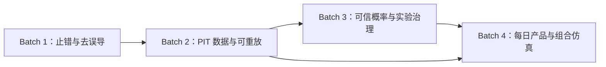

# quant-trading-system 全面分析与修改计划（2026-08-07）

> 交付状态：代码审计与 28 项修改计划已完成；**Batch 1–4 已于 2026-08-07 实施落地（部分为务实 MVP / 披露优先）**，下文各 MP 附实施记录。
>
> 原分析边界：首轮仅分析并编写本计划。实施轮按计划改业务代码/配置/文档；验证以编译、静态验收与手工页面/接口为主，不把单元测试作为验收门槛（适配构造器变更的测试改动除外）。
>
> **实施范围：**
> - Batch 1：MP-001 / MP-006 / MP-007 / MP-008 / MP-010（语义）/ MP-018 / MP-027 / MP-028
> - Batch 2：MP-002 / MP-004 / MP-005 / MP-013（务实）/ MP-014（务实）/ MP-017 / MP-023 / MP-024
> - Batch 3：MP-003 / MP-009 / MP-012（契约桩）/ MP-016 / MP-019 / MP-020 / MP-021 / MP-025
> - Batch 4：MP-011 / MP-015（MVP）/ MP-022 / MP-026；MP-010 完整 raw+漏斗已补齐

路径约定：为控制重复篇幅，本文出现的 `*.vue` 默认位于 `modules/web/src/views/`（路由、布局、API 文件分别位于 `router/`、`layouts/`、`api/`）；Java 类默认位于 `modules/backend-java/src/main/java/com/quant/` 下对应 `controller/service/research/entity/repository` 包；Python 文件均以 `modules/compute-python/` 为根。首次出现的关键证据会同时给出组件/类/方法名，实施时应先用类名定位实际包，不按文档猜建重复文件。

## 实施进度总表（2026-08-07，全量更新）

| MP | 优先级 | 状态 | 怎么改的（摘要） | 验证 |
|---|---|---|---|---|
| MP-001 | P0 | **已完成** | API 一律 `unwrap`；含 research/watchlist | 静态+编译；未浏览器冒烟 |
| MP-002 | P0 | **已完成** | `label_v2_raw_calendar`：市场日历定日 + `market_price_raw`；缺 bar 不顺延；写 `exitPrice` | `mvn clean compile` 成功 |
| MP-003 | P0 | **已完成** | Logistic 强制 strategyType+embargo；单策略采样；baseline_calibrator 禁 promote | 编译+相关单测通过 |
| MP-004 | P1 | **已完成** | 分区内容指纹 hash；insert-only；`requireSnapshot` | 编译成功；未对真实库改价对拍 |
| MP-005 | P1 | **已完成（轻量）** | `replay/signals` 逐日 PIT+在线打分；`FeatureSnapshotManifest` 幂等 | 编译成功 |
| MP-006 | P1 | **已完成（降级）** | 分段稳定性改名；真正 WFO 未建 | 静态核对 |
| MP-007 | P0 | **已完成** | `PointInTimeUniverseProvider` | 编译成功 |
| MP-008 | P0 | **已完成** | 无 challenger fallback | 编译成功 |
| MP-009 | P0 | **已完成** | PAV isotonic；fit 窗 baseline；INSUFFICIENT_DATA | 编译+相关单测 |
| MP-010 | P0 | **已完成** | raw 优先+漏斗字段；胜率改名 filledSampleWinRate | 编译成功；未手算样例 |
| MP-011 | P1 | **已完成** | 预测双轨 generate/daily；概率轨 ABSTAIN | 编译成功 |
| MP-012 | P1 | **已完成（契约桩）** | Java/Python manifest schema + validator；非完整 Parquet | 编译+Python 语法 |
| MP-013 | P1 | **务实完成** | LIMITED_BOOTSTRAP 披露+退市占位 CSV；无外部权威源 | 编译成功 |
| MP-014 | P1 | **务实完成** | `MarketDataBatchService` batch_id；raw=0 拒 PUBLISHED | 编译成功 |
| MP-015 | P1 | **MVP 完成** | 事件驱动组合回测 API+NAV/orders JSON | 编译成功 |
| MP-016 | P1 | **已完成** | ExperimentController register/list/gates/decision | 编译成功 |
| MP-017 | P1 | **已完成** | score_type 拆分 TREND/COMPREHENSIVE | 编译成功 |
| MP-018 | P0 | **已完成** | Flyway V1–V10；prod validate | 编译成功；未实库 migrate |
| MP-019 | P1 | **已完成（诚实披露）** | metric_scopes；稀疏样本 bias note | 编译成功 |
| MP-020 | P1 | **已完成** | Beta banner/门禁/双轨区/错误重试 | 静态+编译 |
| MP-021 | P1 | **已完成** | 禁静默造数；`research run`；DEMO 水印 | Python CLI --help |
| MP-022 | P1 | **已完成** | 日报挂 prediction lineage | 编译成功 |
| MP-023 | P1 | **已完成** | DataQualityGateService 硬闸 | 编译成功 |
| MP-024 | P1 | **已完成** | ResearchTask 异步队列 | 编译成功 |
| MP-025 | P1 | **已完成** | 市值 FLOAT_CAP_APPROX；中性化可降级 | 编译成功 |
| MP-026 | P2 | **已完成（务实）** | 账户按日 raw 价+整手/拒单原因 | 编译成功 |
| MP-027 | P2 | **已完成** | 文档漂移纠正 | 文档核对 |
| MP-028 | P2 | **已完成** | prod 密钥 fail-fast + 前端 401 | 编译成功 |

**全局验证（2026-08-07 末）：** `mvn -DskipTests -Dskip.frontend.build=true clean compile` → **BUILD SUCCESS**（212 sources）。Python `main.py research run --help` 正常。Flyway 重复 V7 已重命名为 V10。**未做全量浏览器冒烟与真实库 migrate。**

## 完成度分类与剩余缺口清单（提交前终核，2026-08-07）

> 口径：计划 28 项 **均已有代码改动**（无“完全未开工”编号）。下表按完成度三分：完整落地 / 半完成(MVP或务实) / 仍未交付的终态能力。运维验收项单独列出。

### A. 完整落地（计划本批次目标已满足）

| MP | 已写入代码的要点 | 仍建议后续验收（非未改代码） |
|---|---|---|
| MP-001 | 全 API `unwrap`；断链页契约修复 | 七页浏览器冒烟 |
| MP-002 | `label_v2_raw_calendar`；日历定日；raw 价；不顺延；`exitPrice` | 除权/停牌样例手算 |
| MP-003 | strategyType+embargo；单策略采样；禁伪多因子 promote | 重叠窗 4xx 接口抽查 |
| MP-004 | 分区内容指纹；insert-only；`requireSnapshot` | 改价后 hash 变化对拍 |
| MP-007 | `PointInTimeUniverseProvider`；五服务+T1 切 PIT | 退市样例对账（依赖 MP-013 数据） |
| MP-008 | 无 challenger fallback；RULE_SCORE+fallback_reason | 三场景页面验证 |
| MP-009 | PAV；fit 窗 baseline；INSUFFICIENT_DATA | 桶数据手算 Brier/ECE |
| MP-010 | raw 优先；executionFunnel；filledSampleWinRate；文案纠正 | 涨跌停样例手算 |
| MP-011 | `/api/predictions/*` 双轨；ABSTAIN | 发布后重开不变 |
| MP-016 | ExperimentController register/list/gates/decision | 晋升二次确认走查 |
| MP-017 | score_type 隔离 TREND/COMPREHENSIVE | 同日三策略独立查询 |
| MP-018 | Flyway V1–V3/V5–V10；prod `validate` | **真实库 migrate 未执行** |
| MP-020 | Beta/门禁/错误重试/双轨区 | 页面走查 |
| MP-021 | 禁静默造数；`research run`；DEMO 水印 | 固定 snapshot 双跑 hash |
| MP-022 | 日报 prediction lineage / NOT_PUBLISHED | 刷新不改写历史 |
| MP-023 | DataQualityGateService 硬闸 | 制造缺 raw 验证 BLOCKED |
| MP-024 | ResearchTask 异步 create/cancel/resume | 刷新/续跑抽查 |
| MP-025 | FLOAT_CAP_APPROX；中性化可跳过 | 抽样对照 |
| MP-026 | 账户 raw+整手+reject_reason | 拒单场景页面 |
| MP-027 | README 路径；进度文档纠正（见下） | 契约清单可持续维护 |
| MP-028 | prod fail-fast；401；路由守卫 | prod profile 实启 |

### B. 半完成 / 务实 MVP（已改，但终态未收口）

| MP | 状态标签 | **已经改了什么** | **还没改到的终态（明确未完成）** |
|---|---|---|---|
| MP-005 | 轻量完成 | `POST /research/replay/signals`；逐日 PIT+在线打分；`FeatureSnapshotManifest` 幂等；pool-health 保留 | 全市场完整特征矩阵重算；分区续跑/原子发布半成品隔离；与在线逐股 golden 对拍自动化 |
| MP-006 | 仅降级完成 | 文案/菜单/meta/`SEGMENT_STABILITY`/`is_oos=false` | **真正滚动 WFO 新入口 `/research/rolling-experiments` 未建**；无 per-window train/cal/test lineage runner |
| MP-012 | 契约桩 | `contracts/*.schema.json`；Java validator/registry；训练写 schema_hash | **Parquet 特征分区流水线未建**；Java/Python 全量对拍未建 |
| MP-013 | 务实完成 | LIMITED_BOOTSTRAP 披露；退市占位 CSV 导入桩；coverage API | **官方历史主数据/退市源未接入**；SCD2 真实更名/ST 事件流未建 |
| MP-014 | 务实完成 | `MarketDataBatchService` batch_id；三层计数；raw=0 拒 PUBLISHED | 完整 staging 表+原子晋升；失败分段续跑编排仍可加强 |
| MP-015 | MVP | `/api/backtest/portfolio/*`；现金/等权/仓位/T+1/整手/NAV JSON | 分钟撮合未做；与账户逐单对账手算未做；订单状态机可再细化 |
| MP-019 | 诚实披露 | metric_scopes；COST_APPROX；稀疏偏差 note；EXECUTABLE=UNAVAILABLE | **完整 PIT 横截面 IC 未切换到 feature snapshot 权威路径**（仍可读 selector_result） |

### C. 跨项仍未交付（运维/验收/后续立项）

1. 真实数据库执行 Flyway migrate（需备份后操作）
2. 第 6 节主旅程浏览器冒烟与固定金融样例手算验收单
3. 真正 Walk-Forward 滚动实验（MP-006 后半）
4. Parquet 离线特征权威流水线（MP-012 后半）
5. 权威证券主数据采购/接入（MP-013 后半）
6. 生产环境 secret 实机启动失败验证（MP-028 抽查）

### D. 文档同步说明

- 本文件为 28 项实施权威记录；每项 MP 正文下均有「实施状态 / 怎么改的 / 验证」块。
- `.cursor/optimization-progress.md` 中 QP-015/experiment「无 Controller」表述已过时，提交时改为：**HTTP API 已接线（MP-016），端到端晋升门禁仍需页面验收**。

## 0. 执行摘要

### 0.1 产品北极星

利用历史数据，在每个交易日筛选未来几天（默认 T+2/T+3，兼顾 T+1）上涨概率较大的可交易 A 股，并以无未来函数、可复现、包含真实交易成本与可交易性约束的回测持续验证。最终输出必须是经样本外验证和校准的概率，而不是把规则分、百分位或经验映射包装成“概率”。

### 0.2 当前阶段判断

项目不是空白原型：规则选股、行情、账户、PIT 相关实体、raw/factor、标签、校准、模型注册等已有较多代码基座。但审计结果显示，它仍是“规则选股产品较完整、概率研究基座较多、可信概率闭环尚未成立”的阶段，不能把进度记录中的 QP-001～QP-013、QP-015 全部视为端到端完成。

四个关键问题已有明确结论：

1. PIT 表目前主要由 current snapshot 派生且 `reliability=limited`，历史打分服务仍直接使用当前 `stock_info`，尚未消除历史 ST、退市、行业变化和生存者偏差。
2. 所谓历史重放当前只做“PIT 主数据 ∩ 当日有行情”的股票池健康统计，没有逐日重算特征与信号。
3. Logistic/校准使用稀疏已保存规则分，存在跨策略覆盖、无 purge/embargo、伪 isotonic 与评估集基线问题，不能产出可上线的 `prob_up_t2/t3`。
4. `data_snapshot` 只 hash 行数与来源分布，并未冻结内容或约束查询；同行数数据被改写时仍会复用同一语义快照。

19 个路由中，静态审计判定 6 个不可用、3 个半残、10 个可用或有限可用；其中 T+1 页面虽能以规则轨工作，但概率 fallback 存在 P0 风险。最终计划共 28 项：**P0 8 项、P1 17 项、P2 3 项**。第一目标不是增加复杂模型，而是修复错误结果、停止误导并建立可复现证据链。

### 0.3 Top 10 必须先做的事

1. MP-008：立即移除 T+1 自动加载 challenger，特征不匹配时只输出规则分。
2. MP-002：用 raw 价和真实交易日历重建 T+2/T+3 标签，保留停牌/拒单样本。
3. MP-007：历史打分全面切换 PIT universe，先阻断当前主数据泄漏。
4. MP-003：禁止重叠训练/评估、跨策略覆盖和单规则分冒充多因子模型。
5. MP-009：纠正校准切分、基线与 isotonic 算法，停止发布 in-sample 指标。
6. MP-010：回测使用 raw 价并闭合信号→成交→拒单样本漏斗。
7. MP-001：统一 Web 响应解包，恢复日报、因子、筛选、稳定性等页面。
8. MP-018：建立版本化 DB migration，生产关闭 Hibernate 自动改表。
9. MP-004：把元数据快照升级为内容不可变 snapshot。
10. MP-023：让数据质量成为预测、实验、晋升和日报发布的硬门禁。

### 0.4 半残/误导功能处置原则

- 会输出错误结果或把分数误称概率的入口：先禁用误导动作或改为真实语义，再恢复功能。
- 主链路半残页：若一个批次内可闭环则修复，否则标注 Beta、禁用不可用操作并展示缺口。
- 非主链路半残页：降级隐藏或删除菜单入口，保留代码以便后续评估。
- Mock/演示数据：正式模式必须显式隔离并可辨识，严禁静默回退到假数据。

## 1. 系统功能与场景地图

### 1.1 用户旅程

1. 日常决策：更新行情与基础数据 → 运行选股/打分 → 查看候选、解释、失效条件和数据版本 → 人工决策 → 次日核销与日报复盘。
2. 研究闭环：构造 PIT 因子 → 按时间点生成标签 → 训练与概率校准 → Walk-Forward 样本外验证 → 组合级回测 → 固化模型/实验版本。
3. 验证闭环：固定交易日与股票样例核对口径 → 模拟账户记录真实可成交价格与成本 → 持仓对账 → 将偏差反馈到数据、信号和执行层。

### 1.2 功能成熟度矩阵

| 维度 | 已有能力 | 当前成熟度 | 核心缺口 | 对应计划 |
|---|---|---|---|---|
| 日常规则选股 | 统一/经典/超跌/趋势/综合打分，T+1 候选 | 可用但有版本/持久化风险 | 历史 PIT、同日覆盖、T+1 模型错配 | MP-007/008/017 |
| 数据底座 | qfq、raw、factor、日历、主数据历史、质量页 | 基座较多但非可信快照 | 三层世代漂移、主数据有限、质量不阻断 | MP-004/013/014/023 |
| 标签/研究 | T+h 标签、校准、Logistic、模型表 | 研究原型，不可发布 | raw/交易日、稀疏混样、切分泄漏、无 artifact | MP-002/003/009/012 |
| 回测 | 前瞻收益、策略回测、分段统计 | 研究工具 | qfq 成交、成功样本偏差、无组合状态 | MP-006/010/015 |
| 实验治理 | Experiment 实体/Service | 仅基座、未接线 | 无 API/UI/门禁/决策证据 | MP-016/020 |
| Python | 演示策略、标签、评估工具 | 与产品脱节 | 静默造数、口径分裂、无产物协议 | MP-012/021 |
| 产品闭环 | 规则页、日报、账户、对账 | 多入口但断链 | 6 路由不可用、无 T2/T3 概率快照/核销 | MP-001/011/022/026 |

### 1.3 与北极星对齐的目标架构

目标架构保持模块化单体，不做微服务拆分：

```text
原始价/复权因子 + PIT 证券主数据 + 财务公告版本 + 真实交易日历/基准
  → 可按 as_of 查询且内容不可变的数据快照
  → 单一权威特征流水线 + feature_set_version
  → T+2/T+3 标签工厂（拒单样本保留）
  → train/validation/calibration/test + purge/embargo 的滚动实验
  → 经独立样本外检验的 prob_up_t2/prob_up_t3 或 ABSTAIN
  → 管理现金、重叠持仓、整手、最低佣金和订单状态的组合回测
  → 每日规则轨/概率轨双轨工作台、日报与事后核销
```

职责边界：Java 负责数据接入、PIT 查询、任务编排、在线 API、结果持久化与页面托管；Python 负责离线特征矩阵、统计研究、模型训练和校准；二者通过带 hash 的 artifact manifest、feature schema 和版本表协作。禁止同一因子在 Java/Python 长期双实现且无对拍。

根据 `.cursor/optimization-progress.md` 的声明，原始价/复权因子表、证券历史表、交易日历/指数、数据快照、重放、标签、校准、Logistic 和实验注册表均已有不同程度基座；本报告将在代码审计后逐项标为“可用 / 半残 / 仅基座 / 未接线”，不重复立项已经闭环的工作。

## 2. 分维度问题清单

### 2.1 Web

1. **[P0，Bug] 多个页面错误消费统一响应包装。** `src/api/request.ts#axiosInstance.interceptors.response` 返回完整 `ApiResponse`，但 `report.ts#getDailyReport/getTrendReport`、`compare.ts#compareStrategies`、`screener.ts` 全部导出函数、`factor.ts#getFactorResearch/getUnifiedFactorReport`、`walkforward.ts#runWalkForward`、`reconcile.ts#reconcilePosition`、`backtest.ts#analyzeTurnover/analyzeStability` 和 `data.ts#getQuality/fetchIndexData/runReplay/buildLabels/getLabelCoverage` 直接把 `request.get/post` 声明为业务对象。对应页面随即访问 `trade_date`、`window_stats`、`items` 等顶层字段，实际字段位于 `data` 下，造成空白、运行时异常或错误空状态。`research.ts` 与 `watchlist.ts` 已使用 `unwrap`，可作为正确模式。
2. **[P1，误导] `/backtest/walk-forward` 实际只是连续窗口分段统计。** `WalkForward.vue` 标题仍为“样本外 / Walk-Forward 简易框架”，`WalkForwardService#run` 只是分窗调用保存结果回测，没有训练、验证、校准、purge 或 embargo，且服务注释明确“仅作分段稳定性研究”。入口继续命名 Walk-Forward 会把普通分段统计误认为样本外泛化证明。
3. **[P1，误导] 打分回测把经验样本比例写成“盈利概率”。** `ScoringBacktest.vue` 多处把 `PeriodStat.winRate` 展示/导出为“盈利概率”，但它是被选样本的历史盈利比例，不是个股条件概率预测；应统一改为“历史样本胜率/盈利样本占比”，并显示样本数与区间。
4. **[P2，可用性] 多个辅助加载静默失败。** `ProbabilityResearch.vue#loadModels`、`AccountView.vue#loadOrders`、`T1Candidate.vue` 的部分加载，以及 `ScoringBacktest.vue` 的历史/策略加载吞掉异常。静默失败会把接口错误伪装成空列表；研究与账户页至少应展示局部错误状态和重试按钮。
5. **[P2，类型债] API 契约存在两套风格。** `market.ts` 明确返回包装对象并由页面取 `.data`，`research.ts/watchlist.ts` 在 API 层解包，其他文件则类型声称已解包但实际未解包。必须统一为“API 模块一律返回业务 `data`”，禁止页面裸 `as {data?: T}`。

### 2.2 Java

1. **[P0，模型误用] T+1 候选会自动加载未晋升 challenger，且特征语义不一致。** `T1CandidateService#loadT1ProbModel` 在找不到 champion 时回退最新 challenger，再把以通用 `selector_result.rule_score` 训练的 Logistic 作用于 T+1 专用 `scoreT1`。同名“规则分”并不代表同一特征分布，结果仍被标为 probability，绕过模型发布门禁。
2. **[P0，历史泄漏] 多个历史打分服务读取当前 `stock_info`。** `StockSelectorService`、`OversoldReboundScoringService`、`StockTrendScoringService`、`MultiDimScoringService`、`ComprehensiveScoringService` 虽接收历史 `tradeDate`，却用 `stockInfoRepository.findAll()` 取得当前上市状态、名称、行业、上市日和股票集合，导致退市股消失、历史行业/名称/状态被未来信息替换。
3. **[P0，标签错误] 标签日期按个股 bar 下标推进且成交价取前复权价。** 详见 MP-002；这是概率目标变量的根因级错误。
4. **[P0，训练泄漏/混样] Logistic 和校准服务混合多个策略结果、缺少 purge/embargo。** 相同股票同日分数可被后遍历策略覆盖；区间可重叠；当前仅有 `rule_score` 单特征，却容易被界面理解为多因子概率模型。
5. **[P1，校准口径] 当前“isotonic”不是单调保序回归。** `ProbabilityCalibrationService` 只是等宽分箱后填经验概率，没有 PAV 单调约束；空桶被置零。Brier 基线又用评估集自身正例率，产生测试集信息参与基线的乐观比较。
6. **[P1，稀疏样本] 回测、校准、因子研究依赖历史已保存的 `selector_result`。** 这不是全市场逐日重放，只覆盖当时被运行并落库的日期、策略和候选，存在选择偏差、日期断层和不可重建问题。
7. **[P1，回测诚信] 打分回测用前复权 OHLC 模拟成交并只汇总成功成交样本。** `ScoringBacktestService` 对 entry/exit 失败会记录原因，但收益汇总只包含成功样本；缺少现金、持仓、信号重叠和组合级订单状态，结果是“条件于可成交样本的前瞻收益统计”，不是组合回测。
8. **[P1，持久化冲突] 趋势打分与综合打分共用 `stock_trend_score` 唯一键和按日删除。** `StockTrendScore` 唯一键仅 `(stock,exchange,trade_date)`，两服务独立运行时会互相覆盖；`factorVersion` 虽存在却不在唯一键。
9. **[P1，实验壳未接线] `ExperimentRun/ExperimentService` 已存在但无 Controller、页面或其他服务引用。** `.cursor/optimization-progress.md` 声称已有注册/列表 API，与代码不符；当前不能把模型、快照、窗口、指标和发布决策串成实验闭环。
10. **[P1，任务化不足] 标签、重放、校准、训练等长任务仍同步执行。** 前端靠 60～120 秒超时等待，无可靠进度、取消、续跑与原子发布；中断后可能留下无法判定完整性的结果。

### 2.3 Python

1. **[P1，架构断层] Python 仍是演示 CLI，未成为离线研究权威实现。** `main.py` 只提供合成数据 smoke 命令；模型训练/校准反而全部在 Java，和目标架构“Python 离线研究、Java 在线服务”不一致。
2. **[P0，静默造数] CSV 缺失时自动生成确定性样本。** `engines/data_engine.py` 没有显式 `--demo` 仍回退模拟数据，研究命令可能在用户不知情时产出看似正式的报告。
3. **[P1，标签口径分裂] `research/labels.py` 使用收盘到未来收盘的简单收益。** 它与 Java 的次日开盘、原始价、费用、可成交性标签不同；两套同名 T+h 标签无法对拍或共同训练。
4. **[P1，重复实现] `engines/oversold_rebound_scorer.py` 与 Java 打分器并存。** 没有共享 feature schema、golden dataset 和版本兼容约束，长期会产生公式漂移。
5. **[P1，产物协议缺失] Python 没有读取数据快照/特征快照、写模型 artifact manifest 或注册实验的链路。** Java 无法验证 artifact 的输入 hash、列顺序、缺失值策略和模型类型。
6. **[P2，环境不可复现] `requirements.txt` 主要使用下界约束，无锁文件，且包含当前 CLI 未形成主链路的依赖。** 不同机器安装出的科学计算栈可能不同，模型 hash 和结果无法稳定复现。

### 2.4 数据与跨层契约

1. **[P0，DB 漂移] 新 JPA 实体没有版本化 SQL，生产依赖 `ddl-auto: update`。** `modules/database/01_init_schema.sql` 只覆盖早期表；`market_price_raw`、`adjust_factor`、`security_master_history`、`trading_calendar`、`data_snapshot`、`label_snapshot`、`model_registry`、`experiment_run`、`selector_result` 等依赖 Hibernate 补表，无法审计迁移顺序或回滚影响。
2. **[P1，快照不冻结内容] 数据快照 hash 只包含行数与来源统计。** 同行数内容被改写时 snapshot hash 不变，研究查询也没有按 snapshot cutoff 读取。
3. **[P1，主数据仅近似 PIT] `security_master_history` 由当前快照派生。** 当前名称/行业/状态被回填到上市日起，缺少历史变更和已退市证券，不能作为历史全市场权威股票池。
4. **[P1，行情链路可漂移] 常规更新只更新前复权 `market_data`，raw/factor 回填是另一条手工接口。** 三层可能覆盖日期不同、来源不同或生成时间不同，标签与特征因此引用不一致的数据世代。
5. **[P1，交易日历仅有限可信] 日历由上证指数 K 线推导。** 分段接口空结果可被静默跳过，初始化完成不等于全区间完整；质量页仍有基于工作日推测缺失日期的旧逻辑。
6. **[P1，市值来源误标] `totalMarketValue` 由 `amount / turnover` 推导。** 换手率通常对应流通口径，该值不应无来源说明地充当总市值并进入市值中性化/加权。
7. **[P1，质量只观测不阻断] 有限来源只要“已初始化”就可显示已启用。** 数据质量没有成为预测生成、模型晋升或日报发布的硬门禁，用户仍可在源不完整时得到正式外观结果。
8. **[P1，跨层版本不闭合] 页面/API/实体缺少统一 lineage。** 预测结果未同时固定 `data_snapshot_id、feature_set_version、model_version、label_version、strategy_version、cost_version`，无法从日报反查完整实验。
9. **[P2，文档契约漂移] README 把打分回测写成 `/api/backtest/scoring/run`，代码与 API 文档实际为 `/api/backtest/scoring`；进度文档又声明不存在的 experiment API。** 文档不能作为可执行验收依据。

## 3. Tab/页面逐项审计表

静态代码审计阶段结论如下；“可用”表示路由、菜单、API 契约在代码上闭合，不代表已完成浏览器冒烟。

| 页面/入口 | 菜单 | API / 核心 Service | 核心数据依赖 | 用户可见能力 | 真实可用度 | 证据与处置建议 | 贡献 |
|---|---:|---|---|---|---|---|---|
| `/data/overview` 数据管理 | 是 | `/api/data/*`；`DataService`、`HistoricalDataUpdateService` | `stock_info/market_data`、更新任务 | 数据概览、初始化与更新任务 | 可用 | `DataManagement.vue` 主接口自行解包；保留，后续接原子批次 | 核心地基 |
| `/data/quality` 数据质量 | 是 | `/api/data/quality`、快照/日历/重放/标签；多个 Service | raw/qfq/factor、日历、主数据、snapshot/label | 看质量并触发研究数据任务 | **半残** | `data.ts#getQuality/runReplay/buildLabels/getLabelCoverage/fetchIndexData` 未解包；修复并拆清质量/研究职责 | 核心地基 |
| `/data/stocks` 股票浏览器 | 是 | `/api/market/stock/list`；`MarketService` | 当前 `stock_info` | 浏览/筛选股票基础资料 | 可用 | `StockBrowser.vue#loadStocks` 显式读包装层，本地回退标来源；仅辅助，不作历史池 | 辅助 |
| `/report/daily` 选股日报 | 是 | `/api/report/daily,/trend`；`DailyReportService` | 保存的选股/趋势结果 | 看当日候选与趋势摘要 | **不可用** | `report.ts` 返回包装层而页面读业务对象；修复后改为 prediction snapshot 日报 | 核心闭环 |
| `/compare/strategies` 策略对比 | 是 | `/api/compare/strategies`；`StrategyCompareService` | 多策略保存结果 | 横向比较候选/分数 | **不可用** | `compare.ts#compareStrategies` 未解包；修复并显示不可横比的版本告警 | 辅助 |
| `/watchlist` 自选股池 | 是 | `/api/watchlist/*`；`WatchlistService/AlertService` | watchlist、最新日线 | 自选管理与最新日线异动 | 可用 | `watchlist.ts` 已解包；“异动非实时”需持续披露 | 辅助 |
| `/market/stock` 股票详情 | 是 | 市场详情/K线/实时/单股分析；`MarketService` | 股票/行情/指标 | 单股行情、图表与分析 | 可用 | `StockDetailView.vue` 显式读 `.data`；统一契约后保留 | 辅助 |
| `/market/kline` K线图 | 是 | `/api/market/kline`；市场 API | 后端 K 线、IndexedDB 缓存 | K线与技术指标浏览 | 可用但需标源 | `KLineView.vue` 已标后端/本地来源；正式模式严禁随机 Mock | 辅助 |
| `/market/stock-picker` 选股打分 | 是 | 统一/经典/超跌/趋势/综合打分；多 Service | 当前/PIT 主数据、qfq、财务、打分结果 | 运行规则选股、看理由与质量 | 可用（规则轨） | `StockPicker.vue` 已写“规则分/非概率”；需修 PIT 与结果覆盖，接双轨 | **核心** |
| `/market/t1-candidate` T+1 候选 | 是 | `/api/research/t1/*`；`T1CandidateService` | 规则分、模型表、行情 | T+1 规则/概率候选 | 规则轨可用；概率危险 | `research.ts` 已解包；后端会回退 challenger 且特征错配，立即执行 MP-008 | 核心补充 |
| `/screener` 条件选股 | 是 | `/api/screener/*`；`ScreenerService` | 当前股票主数据 | 按市场/行业/状态筛选 | **不可用** | `screener.ts` 四函数均未解包；修复后仍只定义为主数据筛选 | 辅助 |
| `/factor/research` 因子研究 | 是 | `/api/factor/research,/unified-report`；`FactorResearchService` | 稀疏 `selector_result`、qfq 行情 | IC、分组与统一报告 | **不可用** | `factor.ts` 未解包；后端样本有选择偏差，“可执行”名不实 | 核心研究 |
| `/research/probability` 概率研究 | 是 | 校准/Logistic/模型注册；Research Services | label、selector result、model registry | 训练、校准、看模型/曲线 | **半残/Research Beta** | 前端契约正确；混策略、无 embargo、伪 isotonic、实验未接线；禁生产语义 | **核心研究** |
| `/backtest/scoring` 打分回测 | 是 | `/api/backtest/scoring` + turnover/stability；`ScoringBacktestService` | 保存候选、qfq 行情 | 候选未来收益与稳定性 | 主功能可用，辅助半残 | 主接口已解包；辅助未解包；仅成功样本、qfq 成交，“盈利概率”需改名 | 核心验证 |
| `/backtest/strategy` 策略回测 | 是 | `/api/backtest/strategy/*`；`StrategyBacktestEngine` | 单股行情、示例策略 | 单股策略区间回测 | 可用 | 独立策略工具，不是概率主航道；维持低优先级 | 噪音/辅助 |
| `/backtest/walk-forward` Walk-Forward | 是 | `/api/backtest/walk-forward`；`WalkForwardService` | 保存候选、打分回测结果 | 分窗查看收益稳定性 | **不可用且误名** | API 未解包；实现只有分段统计。立即改名“非样本外” | 核心验证 |
| `/account/overview` 模拟账户 | 是 | 账户/持仓/订单；`SimAccountService` | 账户表、最新 qfq 行情 | 模拟买卖、持仓与订单 | 可用但口径简化 | API 已解包；订单错误静默，成交价/订单规则需与组合回测统一 | 辅助验证 |
| `/reconcile/position` 持仓对账 | 是 | `/api/reconcile/position`；`ReconcileService` | 账户持仓与输入仓位 | 比较并解释持仓差异 | **不可用** | `reconcile.ts#reconcilePosition` 未解包；修复并区分空/错/真差异 | 辅助验证 |
| `/login` 登录 | 是 | `/api/auth/login,/register`；`AuthService` | 用户/凭证 | 登录/注册 | 可用（开发） | 默认账号与 secret 只适合 local；补路由守卫、401 与生产强制配置 | 工程辅助 |

## 4. 详细修改计划（MP-001…）

### MP-001 [P0] 修复 Web 统一响应解包，恢复七个直接不可用页面

> **实施状态（2026-08-07）：已完成**  
> **怎么改的：** `request.ts` 明确返回 `ApiResponse<T>` 并保留 `unwrap`；`report/compare/screener/factor/walkforward/reconcile/backtest/data/market/research/watchlist/account/auth/selector/scoring` 一律 `await request.*` 后 `unwrap`；原先计划误标「已解包」的 `research.ts`/`watchlist.ts` 一并修复；`StockDetailView`/`KLineView`/`StockBrowser` 去掉页面侧裸 `.data`。  
> **验证：** 静态检查 api 层无 `return request.get/post`；后端无关。`vue-tsc` 后 API 相关错误已收敛。**未启动前后端做七页冒烟**（需本地服务）。  
> **剩余：** 有数据/空数据/网络错误三态展示可在页面侧继续加强（属 MP-001 步骤 4 的体验项）。

- 问题现状：响应拦截器返回 `{code,message,data}`，多个 API 方法却把整个包装对象声明成业务对象；页面读取不存在的顶层字段，出现空白、异常或假空状态。
- 证据位置：
  - 前端：`modules/web/src/api/request.ts#axiosInstance.interceptors.response/unwrap`；`report.ts#getDailyReport/getTrendReport`；`compare.ts#compareStrategies`；`screener.ts`；`factor.ts`；`walkforward.ts#runWalkForward`；`reconcile.ts#reconcilePosition`；`backtest.ts#analyzeTurnover/analyzeStability`；`data.ts#getQuality/fetchIndexData/runReplay/buildLabels/getLabelCoverage`。
  - 后端：各对应 Controller 均返回 `ApiResponse.success(data)`，进一步证明前端需要取 `data`。
- 影响：日报、因子研究、数据质量和分段验证等主闭环入口不能可靠工作，用户可能把“接口接线错误”误判为没有候选/没有数据。
- 目标行为：所有 API 模块对页面只返回业务 `data`；后端业务空数据与网络/契约错误有不同页面状态。
- 实现步骤：
  1. 将 `request.ts` 的客户端返回类型改为 `Promise<ApiResponse<T>>`，保留统一 `unwrap<T>`。
  2. 在上述 API 文件逐个 `await request.*` 后调用 `unwrap<T>`；`market.ts` 也迁移为同一风格，同步移除页面裸 `.data`。
  3. 对 `data.ts#getQuality` 等现有 `any` 定义补最小业务类型；禁止用 `as unknown as` 掩盖包装层。
  4. 为局部请求补错误对象与重试状态，不把异常转为空数组。
- 涉及文件（预计）：`modules/web/src/api/request.ts`、`report.ts`、`compare.ts`、`screener.ts`、`factor.ts`、`walkforward.ts`、`reconcile.ts`、`backtest.ts`、`data.ts`、`market.ts`及对应 views。
- 接口/字段契约：HTTP JSON 不变；仅前端 API 函数返回值从 `ApiResponse<T>` 实际对象统一为 `T`。
- 数据/迁移：无。
- 功能验证步骤（手工/页面）：
  1. 依次打开数据质量、选股日报、策略对比、条件选股、因子研究、Walk-Forward、持仓对账。
  2. 使用有数据日期运行查询；再使用无数据日期；最后停止后端模拟网络错误。
  3. 有数据时展示业务字段；无数据时展示诚实空态；网络错误时展示错误与重试，三者不可混淆。
- 验收标准：七个页面不再读取 `undefined`；浏览器控制台无字段层级异常；API 模块不存在“声明 `Promise<T>` 却直接 return `request`”的模式。
- 依赖项：无。
- 预计复杂度：M。
- 建议执行者：Web。
- 明确不要做的事：不改后端统一响应结构；不新增测试代码；不顺手重做页面样式。

### MP-002 [P0] 用原始不复权价和真实市场交易日重建 T+2/T+3 标签

> **实施状态（2026-08-07）：已完成**  
> **怎么改的：** 默认 `label_v2_raw_calendar`；`TradingCalendarService.nextTradingDay/tradingDayAfterN` 定 entry/exit；按日查 `MarketPriceRaw`，缺 bar/零量不顺延；FILLED 写 `exitPrice`；`priceSource`/`dataSnapshotId` 字段；`label_v1*` 保留旧路径。Flyway V3。  
> **验证：** `mvn clean compile` 成功。**未做除权/停牌样例手算对拍。**

- 问题现状：标签工厂已建 `market_price_raw`，却仍从前复权 `market_data` 取入场/退出成交价；并按“该股票有 K 线的 bar 序列”取下一日与退出日，停牌缺 bar 时会把入场/退出顺延到更晚日期，而不是在市场交易日上记录 `SUSPENDED/NOT_SELLABLE`。
- 证据位置：
  - 后端：`research/LabelFactoryService#buildSingleLabel` 调用 `MarketDataRepository.findByStock...`，以 `fwdBars.get(1)` 入场、`fwdBars.get(1+horizon)` 退出；`entity/MarketData` 无原始价来源字段；`entity/MarketPriceRaw` 注释明确“专供成交仿真”。
  - DB：`label_snapshot.source` 当前固定 `derived_local`，没有 price snapshot/version。
- 影响：未来除权可改写历史成交价；停牌股票的持有期和成交状态被错算，直接污染 `y_label`、净收益、校准与所有概率模型，属于错误训练标签。
- 目标行为：信号、入场、退出日期先由统一市场交易日历确定；指定日无原始 bar 即产生明确拒单/挂单状态；成交价格只来自锁定版本的 raw OHLCV。
- 实现步骤：
  1. 由 `TradingCalendarService` 计算 `signalDate → entryDate → exitDate(h)`，禁止使用个股 bar 下标定义市场日期。
  2. 批量读取 `MarketPriceRaw` 的 signal/entry/exit 与持有区间；涨跌停前收也使用 raw 价。
  3. 缺 entry bar/零量标为 `SUSPENDED/NOT_BUYABLE`；退出缺 bar按冻结口径标为 `SUSPENDED/DELISTED/NOT_SELLABLE`，不得自动顺延且不披露。
  4. `LabelSnapshot` 保存 raw source、data snapshot id、entry/exit raw price；补写当前遗漏的 `exitPrice`。
  5. 新标签使用新 `label_version`，旧 `label_v1` 标记 legacy，不覆盖。
- 涉及文件（预计）：`LabelFactoryService.java`、`MarketPriceRawRepository.java`、`LabelSnapshot.java`、`ResearchConvention.java`、`ResearchController.java`、`DataQuality.vue/data.ts`、数据库迁移脚本。
- 接口/字段契约：标签构建响应新增 `price_source`、`data_snapshot_id`、各拒单状态计数；覆盖率响应区分 legacy/current。
- 数据/迁移：新增 `label_snapshot.data_snapshot_id/price_source`；生成 `label_v2_raw_calendar`，旧标签只读保留。
- 功能验证步骤（手工/页面）：
  1. 选择一个除权样例、一个入场日停牌样例、一个持有期停牌样例和正常样例运行标签构建。
  2. 对照原始价表与市场日历核对 entry/exit 日期、价格、状态和净收益。
  3. 重跑同 snapshot，结果与计数不变。
- 验收标准：正常样例净收益可手算一致；停牌不再被顺延伪装成交；任何新标签均可追溯 raw source/snapshot；`exit_price` 非空（FILLED）。
- 依赖项：MP-004、MP-005。
- 预计复杂度：L。
- 建议执行者：Java/数据。
- 明确不要做的事：不回写旧标签；不使用前复权价模拟成交；不删除拒单样本；不新增测试类。

### MP-003 [P0] 阻止 Logistic 的重叠窗口、策略混分和“伪多因子”发布

> **实施状态（2026-08-07）：已完成**  
> **怎么改的：** 必填 `strategyType`；`ResearchWindowValidator` 校验区间+horizon embargo；`StrategyBoundSampleCollector` 单策略采样；注册 `baseline_calibrator`/`promote_disabled`。  
> **验证：** 编译 + Logistic 相关单测通过。

- 问题现状：接口接受任意 train/test 日期，代码未校验区间分离或 embargo；所谓 Logistic 只有单特征 `rule_score`，并把同日不同策略的最新结果汇入同一 `scoreByKey`，相同股票的分数按迭代顺序覆盖，策略来源不可确定。
- 证据位置：`ResearchController#trainLogistic`；`research/LogisticModelTrainer#train/collectData`；常量 `FEATURE_RULE_SCORE`；`latestByKey(strategy|date)` 后再按日期合并多个 resultId，`scoreByKey.put(stock|exchange, finalScore)` 覆盖；方法中没有对 `trainEnd/testStart/horizon` 的校验。
- 影响：训练/测试可直接重叠，标签跨边界泄漏；不同含义和量纲的策略分混在一起，模型与模型注册表声称的 OOS 指标不可解释，不能作为上涨概率。
- 目标行为：Baseline 校准明确绑定一个 `strategy_type + factor_version + score_type`；训练、校准、测试按市场交易日 purge/embargo；未接入特征快照前只叫“规则分校准基线”，不得作为 champion。
- 实现步骤：
  1. 请求强制加入 `strategyType/factorVersion/dataSnapshotId`，按唯一结果版本取样。
  2. 校验 `trainStart≤trainEnd<testStart≤testEnd`，并以交易日历保证至少 `horizon` 日 embargo；不满足返回 4xx 业务错误。
  3. 样本键加入 result/model lineage，重复股票不得被其他策略覆盖。
  4. 模型注册表把 `feature_version=rule_score_v1` 标为 `baseline_calibrator`；在 MP-012 特征矩阵完成前禁用 promote。
  5. 前端显示绑定策略、版本、真实窗和 embargo，而不是只显示“Logistic 模型”。
- 涉及文件（预计）：`LogisticModelTrainer.java`、`ResearchController.java`、`ModelVersion.java`、`SelectorResultRepository.java`、`research.ts`、`ProbabilityResearch.vue`、迁移脚本。
- 接口/字段契约：`POST /api/research/logistic/train` 新增必填 `strategyType`、可选/解析后的 `factorVersion`、必填 `dataSnapshotId`；响应新增 `embargo_days/result_ids/sample_lineage`。
- 数据/迁移：模型注册表新增 `strategy_type/data_snapshot_id/output_kind`；旧模型 stage 改为 `legacy_research`。
- 功能验证步骤（手工/页面）：尝试重叠区间应被拒绝；选择两个策略分别训练，样本数和 lineage 独立；同配置重跑指标一致。
- 验收标准：训练/测试无日期和标签重叠；每条样本只有一个明确策略分；页面不得把单规则分模型展示为多因子概率模型。
- 依赖项：MP-005；正式多因子模型依赖 MP-012。
- 预计复杂度：L。
- 建议执行者：Java/全栈。
- 明确不要做的事：不先上 GBDT；不靠随机打乱切分；不把旧模型直接晋升 champion；不新增测试代码。

### MP-004 [P1] 把元数据登记升级为内容不可变的数据快照

> **实施状态（2026-08-07）：已完成**  
> **怎么改的：** 分区内容指纹（count/min/max/sum/ingested）写入 manifest；hash 含分区；只 insert；`requireSnapshot`；响应 `manifest_hash/partition_count`。  
> **验证：** 编译成功。**未在库内改价后创建 B 对拍。**

- 问题现状：`DataSnapshotService#computeHash` 只 hash 各表行数和 source 分布；同样行数的价格被改写时 hash 不变，snapshotId 也没有被查询层用于冻结数据。
- 证据位置：`service/DataSnapshotService#createSnapshot/computeHash`；类注释明确“当前为元数据快照，非完整数据内容 hash”；`HistoricalReplayService` 与 `LabelFactoryService` 均不接收 snapshotId。
- 影响：实验、标签和模型声称可复现但实际读取可变当前表，旧结果无法证明使用了哪一版数据。
- 目标行为：snapshot manifest 固定分区内容 hash、最大 ingested_at/vendor version 和质量状态；研究任务必须引用 snapshot 并拒绝读取 cutoff 后数据。
- 实现步骤：按月/表生成稳定排序的分区 hash；保存 manifest；PIT Repository 增 snapshot/cutoff 查询；标签/特征/实验外键引用；数据被更正时创建新 snapshot，不 update 旧 manifest。
- 涉及文件（预计）：`DataSnapshotService.java`、`DataSnapshot/Repository`、行情与 PIT repositories、研究 services、数据库迁移、DataQuality 页面。
- 接口/字段契约：创建快照返回 `manifest_hash/partition_count/cutoff/quality_gate`；研究运行接口必填 snapshotId。
- 数据/迁移：新增 `data_snapshot_partition_manifest`；旧快照标 `metadata_only=true`。
- 功能验证步骤（手工/页面）：创建快照 A，改正一条测试行情后创建 B；B hash 必须变化，A manifest 不变；用 A/B 重跑分别可追溯。
- 验收标准：同行数内容改变可被检测；研究任务不能读取 snapshot cutoff 后记录；旧 manifest 不可变。
- 依赖项：无；MP-002/003/005/012 依赖本项。
- 预计复杂度：L。
- 建议执行者：Java/数据。
- 明确不要做的事：不把全量特征 JSON 塞进 MySQL；不覆盖旧 snapshot；不新增测试代码。

### MP-005 [P1] 将“历史重放”从股票池报告补成可复现信号重算

> **实施状态（2026-08-07）：轻量完成**  
> **怎么改的：** 保留 pool-health；新增 `POST /research/replay/signals` + `HistoricalSignalReplayService`；逐日 PIT+在线打分（persist=false）；`FeatureSnapshotManifest` 幂等；任务类型 `REPLAY_SIGNALS`。  
> **验证：** 编译成功。完整全市场特征矩阵/Parquet 仍属后续。

- 问题现状：页面和规划称“历史逐日重放”，实际 `HistoricalReplayService#replayPoolHealth` 只计算 PIT 主数据与行情交集及过滤计数，不计算特征、不调用打分引擎、不产生信号或 feature snapshot。
- 证据位置：`HistoricalReplayService` 类注释和返回 `daily/summary`；`ResearchController#replay` 只有起止日；`DataQuality.vue` 将入口放在“PIT 股票池健康”。
- 影响：校准/Logistic 仍依赖过去人工保存的稀疏 `selector_result`，训练样本并非任意历史日全市场重算，造成选择偏差和覆盖断层。
- 目标行为：输入 snapshot、策略/feature 版本和区间，逐交易日生成完整特征、规则分、过滤原因与 dataset health；幂等、可续跑、可取消。
- 实现步骤：
  1. 保留现有 pool-health 端点并改名，避免破坏；新增异步 replay task。
  2. 复用 `CodexShortCycleScoringEngine/ClassicFactorCalculator` 的权威实现生成 feature snapshot，明确每个字段 known_at。
  3. 结果键固定 `(snapshot,signal_date,stock,feature_set_version,strategy_version)`，写 manifest/hash。
  4. 支持按日期分区续跑与失败重试，半成品不得发布。
  5. 页面展示覆盖率、缺失/过滤/失败原因和版本，不只展示池规模。
- 涉及文件（预计）：新 `HistoricalSignalReplayService/FeatureSnapshot`，现 `HistoricalReplayService/ResearchController`，打分引擎适配层、repository、数据库迁移、`DataQuality.vue/data.ts`。
- 接口/字段契约：现 `/research/replay` 保留为 `/research/replay/pool-health` 兼容；新增异步 create/status/cancel，参数含 snapshotId/strategy/featureVersion/date range。
- 数据/迁移：新增 feature snapshot manifest/分区存储与 replay task 表。
- 功能验证步骤（手工/页面）：选固定 20 个交易日运行；中断后续跑；对一个日期与在线选股同版本结果逐股对拍；重复运行 hash 相同。
- 验收标准：不依赖历史 selector_result 也能得到逐日全池信号；在线/离线同版本一致；失败不发布半成品。
- 依赖项：MP-004。
- 预计复杂度：L。
- 建议执行者：Java/全栈。
- 明确不要做的事：不复制一套新因子公式；不静默跳过失败日期；不新增测试代码。

### MP-006 [P1] 将现有 Walk-Forward 降级为“分段稳定性”，另建真正滚动实验

> **实施状态（2026-08-07）：Batch1 降级改名已完成；真正滚动实验未建**  
> **怎么改的：** `WalkForward.vue` 标题/警告、`MainLayout` 菜单、`router` meta、导出文件名改为分段稳定性；`WalkForwardService` 注释与响应增加 `analysis_kind=SEGMENT_STABILITY`、`is_oos=false` 及醒目 note；路径 `/backtest/walk-forward` 兼容保留。  
> **验证：** 静态文案与字段核对通过；**未跑分段接口**。新 `/research/rolling-experiments/*` 仍待 Batch3+。

- 问题现状：`WalkForwardService#run` 只是把区间等分后重复 `ScoringBacktestService#run`，但路由、菜单、标题和 API 均称 Walk-Forward/样本外。
- 证据位置：`WalkForwardService`、`WalkForward.vue`、`router/index.ts`、`MainLayout.vue`、`walkforward.ts`。
- 影响：用户会把没有训练/校准隔离的分段收益当作样本外证据，错误晋升策略或模型。
- 目标行为：立即把旧页/接口产品名称改为“分段稳定性（非 Walk-Forward）”；真正 WFO 仅在完成滚动 train/validation/calibration/test 后提供新入口。
- 实现步骤：先改路由 meta、菜单、页面标题、说明、导出文件名和服务 note；修复响应解包；随后基于 experiment registry 新建滚动 runner，采用 purge+embargo，测试窗只使用此前数据；每窗保存模型与预测。
- 涉及文件（预计）：现有 WalkForward 前后端文件、路由/布局；新 `RollingExperimentRunner`、实验实体/API/页面。
- 接口/字段契约：旧 `/backtest/walk-forward` 保留兼容但响应加 `analysis_kind=SEGMENT_STABILITY,is_oos=false`；新 `/research/rolling-experiments/*`。
- 数据/迁移：实验表新增 window manifest；无破坏迁移。
- 功能验证步骤（手工/页面）：旧页醒目标明非 WFO；新任务逐窗展示 train/calibration/test 日期，任何窗口训练截止必须早于测试开始且满足 embargo。
- 验收标准：产品中不存在把旧实现称为样本外/WFO的文案；真正 WFO 每窗 lineage 可追溯。
- 依赖项：MP-001、MP-003、MP-004、MP-005、MP-012。
- 预计复杂度：L。
- 建议执行者：全栈。
- 明确不要做的事：不在旧分段统计上加一个“样本外”标签冒充完成；不自动调参复用测试窗；不新增测试代码。

### MP-007 [P0] 所有历史选股改用按日证券主数据，消除生存者与未来状态泄漏

> **实施状态（2026-08-07）：代码切换已完成（数据仍 LIMITED）**  
> **怎么改的：** 新增 `PointInTimeUniverseProvider`（优先 `security_master_history`，空则回退 `stock_info` 并强制 `PIT_LIMITED`）；`StockSelector/Oversold/Trend/MultiDim/Comprehensive` 与 `T1Candidate` 历史路径改为一次 `loadAsOf(tradeDate)`；结果 Map 合并 `universe.lineage()`。  
> **验证：** 五服务内无 `stockInfoRepository.findAll()`；`mvn -DskipTests -Dskip.frontend.build=true compile` **BUILD SUCCESS**。权威退市/ST 历史仍依赖 MP-013。  
> **未验证：** 更名/退市样例的手工对账。

- 问题现状：多个打分服务接收历史日期，却从当前 `stock_info` 取股票集合、状态、名称、行业和上市日期；退市股与历史变更被当前截面覆盖。
- 证据位置：`StockSelectorService`、`OversoldReboundScoringService`、`StockTrendScoringService`、`MultiDimScoringService`、`ComprehensiveScoringService` 中的 `stockInfoRepository.findAll()`；`SecurityMasterHistoryService` 注释承认当前仅由 current snapshot 派生。
- 影响：历史横截面含未来信息，样本、行业中性化、候选池规模与回测结果均不可用于训练或样本外结论。
- 目标行为：任何带 `tradeDate/asOfDate` 的选股、重放、因子与回测路径，只能使用该日已知且有效的证券主数据；来源有限时显式降级并禁止模型晋升。
- 实现步骤：新增统一 `PointInTimeUniverseProvider`；按 `valid_from≤date<valid_to` 查询；把五个服务的当前表依赖替换为 PIT DTO；过滤规则记录 `master_source/master_snapshot/reliability`；补齐历史源前将结果标为 `PIT_LIMITED`。
- 涉及文件（预计）：上述五个 Service、`SecurityMasterHistoryRepository/Service`、新 Universe Provider、相关结果 DTO/实体、研究与选股页面、迁移脚本。
- 接口/字段契约：选股/回测/重放响应新增 `universe_as_of/master_source/master_reliability`；`PIT_LIMITED` 不允许作为 champion 证据。
- 数据/迁移：主数据历史表补 `source、known_at、snapshot_id、reliability`；不覆盖既有派生记录。
- 功能验证步骤（手工/页面）：固定一个更名/行业变更样例、一个退市样例、一个历史在市样例，在变更前后日期查询并核对股票池与属性；当前快照回填数据必须显示有限可信。
- 验收标准：历史服务不再直接调用 `stockInfoRepository.findAll()`；同一历史 snapshot 重跑股票池一致；退市证券不会因当前表缺失而自动消失。
- 依赖项：权威历史源接入见 MP-013；代码切换可先于数据完善。
- 预计复杂度：L。
- 建议执行者：Java/数据。
- 明确不要做的事：不把当前行业回填冒充历史行业；不因源不全而静默删股；不新增测试代码。

### MP-008 [P0] 封死 T+1 未发布模型与特征错配，恢复规则轨安全退化

> **实施状态（2026-08-07）：已完成**  
> **怎么改的：** `T1CandidateService#loadT1ProbModelWithReason` 仅加载 `stage=champion`；删除 latest/challenger fallback；`featureVersion` 须含 `t1` 且不得为通用 `rule_score_v1`/`selector_result`；否则 `score_type=RULE_SCORE`、不写 `probability`、返回 `fallback_reason`；`T1Candidate.vue` 标题/标签改为规则轨优先。  
> **验证：** 静态确认无 `findFirstByHorizonOrderByCreatedAtDesc` 回退；编译成功。**未做无 champion / schema 不匹配 / 匹配 champion 三场景页面跑通**。

- 问题现状：T+1 服务找不到 champion 时会加载最新 challenger；该模型用通用选股 `rule_score` 训练，却直接接收 T+1 专用 `scoreT1`，然后输出 `probability`。
- 证据位置：`T1CandidateService#loadT1ProbModel` 的 champion→latest fallback；`generate` 对 `scoreT1` 调用模型；`LogisticModelTrainer#FEATURE_RULE_SCORE/collectData` 从 `selector_result.finalScore` 训练。
- 影响：未经批准、输入分布不匹配的模型被自动上线，概率字段不具统计含义，属于面向用户的高风险误导。
- 目标行为：只允许 `stage=champion` 且 `feature_schema_hash/input_strategy/output_horizon` 全匹配的模型推理；否则明确回退 `RULE_SCORE`，不产生概率值。
- 实现步骤：移除 challenger fallback；模型 artifact 保存并校验 schema/hash/range；T+1 单独构建训练数据或只维持规则轨；推理前校验版本、snapshot 兼容性与质量门禁；页面展示回退原因。
- 涉及文件（预计）：`T1CandidateService.java`、`LogisticModelTrainer.java`、`ModelRegistryService/ModelVersion`、`T1Candidate.vue`、`research.ts`、数据库迁移。
- 接口/字段契约：候选项固定返回 `score_type=RULE_SCORE|CALIBRATED_PROBABILITY`、`model_version` 可空、`fallback_reason`；规则轨的 `probability` 必须为空而非复用分数。
- 数据/迁移：模型表新增 `feature_schema_hash/input_strategy/output_horizon`；现有模型全部标 `legacy_research`，人工审核后才能迁移 stage。
- 功能验证步骤（手工/页面）：无 champion、仅不匹配 champion、匹配 champion 三种场景分别运行；前两种只显示规则分与原因，第三种才显示概率和模型版本。
- 验收标准：代码不存在自动加载 challenger 的路径；schema 任一不匹配即拒绝推理；页面不把规则分格式化为百分比概率。
- 依赖项：MP-003、MP-012；紧急移除 fallback 无依赖。
- 预计复杂度：M。
- 建议执行者：Java/Web。
- 明确不要做的事：不把“最新模型”等同“已发布模型”；不通过字段改名掩盖语义错配；不新增测试代码。

### MP-009 [P0] 重做概率校准的样本绑定、时间切分、基线与单调算法

> **实施状态（2026-08-07）：已完成**  
> **怎么改的：** 绑定 strategyType；PAV isotonic；fit 窗 base rate 作 baseline；eval&lt;20 → `INSUFFICIENT_DATA`；响应含 calibrator_hash/bin_counts。  
> **验证：** 编译 + 校准相关单测通过。

- 问题现状：校准混合多策略稀疏结果、无 purge/embargo；小样本可报告 in-sample；“isotonic”仅为等宽分箱且不保证单调；Brier baseline 使用评估集正例率。
- 证据位置：`ProbabilityCalibrationService#calibrate/collectSamples/fitIsotonicLike`；`evalBaseRate` 参与 baseline Brier；少于 20 条时复用同批样本评估。
- 影响：ECE/Brier/可靠性曲线可能乐观或数学含义错误，无法作为“上涨概率可信”的验收证据。
- 目标行为：校准绑定唯一策略/特征/标签/快照；训练校准窗与评估窗严格时序隔离并 embargo；实现真正 PAV isotonic 或清楚命名分箱校准；基线概率只从此前训练/基准期取得。
- 实现步骤：复用 MP-003 的样本 lineage；不足最低 OOS 样本直接 `INSUFFICIENT_DATA`；实现 PAV 并持久化断点；同时保留 Platt baseline；以训练窗 base rate 计算 baseline；输出每桶样本数、置信区间、空桶状态。
- 涉及文件（预计）：`ProbabilityCalibrationService.java`、校准 artifact/实体、`ResearchController.java`、`ProbabilityResearch.vue/research.ts`、迁移脚本。
- 接口/字段契约：请求增加版本与窗口参数；响应增加 `evaluation_kind、baseline_source、embargo_days、bin_counts、confidence_interval、calibrator_hash`。
- 数据/迁移：校准 artifact 独立版本化；旧记录标 `legacy_non_monotonic`，不可晋升。
- 功能验证步骤（手工/页面）：提交重叠窗口应被拒绝；小样本显示不足；可靠性曲线的校准输出单调；用页面导出桶数据手算两桶 Brier/ECE 与训练窗 baseline。
- 验收标准：只报告 OOS 校准指标；isotonic 输出非递减；评估标签不参与基线概率估计；每项指标可追溯样本版本。
- 依赖项：MP-002、MP-003、MP-004、MP-005。
- 预计复杂度：L。
- 建议执行者：Java/Python/Web（最终算法归 Python，过渡修复可在 Java）。
- 明确不要做的事：不把分箱图称为 isotonic；不以测试集正例率作“天真模型”输入；不发布 in-sample 指标；不新增测试代码。

### MP-010 [P0] 统一回测与因子“可执行收益”的原始价、成交状态和分母口径

> **实施状态（2026-08-07）：已完成（文案+raw优先+漏斗）**  
> **怎么改的：** 前端胜率/IC 改名；`ScoringBacktestService` 优先 `market_price_raw`，响应 `executionFunnel`/`filledSampleWinRate`/`priceSource`；因子研究 `metric_scope=COST_APPROX`。  
> **验证：** 编译成功。**未做除权/涨停样例手算。**

- 问题现状：`ScoringBacktestService` 用前复权 `market_data` 开收盘模拟成交，汇总只纳入成功收益；`FactorResearchService` 的“可执行净 IC”也使用复权价和费用，但没有成交量、停牌、涨跌停拒单。
- 证据位置：`ScoringBacktestService` 的 entry/exit MarketData 查询、`periodReturns` 添加条件；`FactorResearchService` 的 gross/net forward return 构造；`MarketPriceRaw` 已明确是成交仿真表。
- 影响：企业行动污染价格；跳过的难成交样本不进入总分母，胜率/收益可能被抬高；“可执行”名称超出真实能力。
- 目标行为：市场交易日决定时间轴，raw OHLCV 与统一订单规则决定成交；报告同时展示信号数、可买数、成功退出数、拒单/冻结数，并区分 signal-level、filled-only、portfolio-level 指标。
- 实现步骤：抽取 `ExecutionPrice/TradabilityPolicy` 权威组件；回测和标签共用；先把因子页字段改名为“成本后近似 IC”，待接入成交规则才恢复“可执行”；所有跳过原因进入固定分母漏斗；旧结果标 legacy。
- 涉及文件（预计）：`ScoringBacktestService.java`、`FactorResearchService.java`、新执行策略组件、raw repository、回测/因子 DTO、两个页面、迁移脚本。
- 接口/字段契约：响应新增 `signal_count/buyable_count/filled_count/frozen_count/reject_reasons/price_source/metric_scope`；旧 `winRate` 明确为 `filledSampleWinRate`。
- 数据/迁移：回测运行记录新增口径与 raw snapshot；不改写旧结果。
- 功能验证步骤（手工/页面）：用正常、除权、停牌、涨停买不到、跌停卖不出各一例核对漏斗；页面指标分母之和必须与信号数闭合；raw 手算收益一致。
- 验收标准：新成交收益不读取 qfq 价；任何跳过都有原因且计入漏斗；页面不再无条件使用“可执行”与“盈利概率”。
- 依赖项：MP-002、MP-004；组合级指标依赖 MP-015。
- 预计复杂度：L。
- 建议执行者：Java/Web/数据。
- 明确不要做的事：不删除难成交样本；不把 adjusted price 重命名为 raw；不在订单引擎完成前声称完整组合回测；不新增测试代码。

### MP-011 [P1] 建立每日 T+2/T+3 规则轨/概率轨双轨预测快照

> **实施状态（2026-08-07）：已完成**  
> **怎么改的：** `PredictionService` + `/api/predictions/generate|daily`；规则轨必发；概率轨需 champion+`DAILY_PUBLISH` PASS 否则 ABSTAIN；Flyway V8。  
> **验证：** 编译成功。

- 问题现状：当前产品以规则选股、T+1 规则候选和研究页为主，没有稳定的“每日 T+2/T+3 概率候选快照”；模型不可信时也缺少统一 abstain/回退协议。
- 证据位置：`StockPicker.vue` 只展示规则分；`T1CandidateService` 仅 horizon=1；`DailyReportService` 没有完整模型 lineage；路由没有 T2/T3 每日概率工作台。
- 影响：北极星用户旅程无法闭合；研究结果与每日可消费候选之间断层，且容易通过临时接口把研究模型误当生产预测。
- 目标行为：每个交易日生成不可变预测快照：规则轨始终可用，概率轨仅在 champion、schema、数据质量、覆盖率全部通过时输出，否则 `ABSTAIN` 并显示原因。
- 实现步骤：新增日批 orchestrator；分别为 horizon 2/3 生成规则候选和已校准概率；写入 lineage、过滤原因与质量门禁；页面以双轨列展示；日报引用已发布快照而非即时重算。
- 涉及文件（预计）：新 PredictionRun/Snapshot/Service/Controller/Repository，打分与模型推理适配、`StockPicker.vue` 或新工作台、`DailyReportService`、迁移脚本。
- 接口/字段契约：`GET /api/predictions/daily?date=&horizon=` 返回 `RULE_SCORE` 与 `CALIBRATED_PROBABILITY|ABSTAIN`，携带完整版本链和 `abstain_reason`。
- 数据/迁移：新增 prediction run/snapshot 明细，唯一键包含日期、horizon、轨道、版本和股票；发布记录不可覆盖。
- 功能验证步骤（手工/页面）：分别在模型可用、无 champion、数据质量失败、特征覆盖不足时生成；页面应保持规则轨可用，概率轨只有首种情况显示数值。
- 验收标准：每日候选可重开复现；概率值必有 champion 与校准版本；任何门禁失败都不以 0%/空列表冒充正常结果。
- 依赖项：MP-002、MP-004、MP-005、MP-008、MP-009、MP-012、MP-023。
- 预计复杂度：L。
- 建议执行者：全栈。
- 明确不要做的事：不自动下单；不以规则分除以 100 冒充概率；不在请求时临时训练；不新增测试代码。

### MP-012 [P1] 建立唯一特征快照与 Java/Python artifact 契约

> **实施状态（2026-08-07）：契约桩完成（非完整 Parquet 流水线）**  
> **怎么改的：** `contracts/*.schema.json`；Java `ArtifactManifestValidator`/`ModelRegistryService`；训练 artifact 写 schema_hash。  
> **验证：** 编译 + Python 语法。大矩阵离线流水线未建。

- 问题现状：Java 持有线上打分、训练与校准，Python 另有示例因子/标签；没有 feature schema、缺失值规则、列顺序、hash 和模型 artifact 的共同协议。
- 证据位置：Java `ClassicFactorCalculator/CodexShortCycleScoringEngine/LogisticModelTrainer`；Python `engines/oversold_rebound_scorer.py`、`research/labels.py`、`main.py`；两侧无 manifest 读写适配。
- 影响：离线与在线特征漂移不可检测；模型无法证明输入兼容；双实现维护成本持续增长。
- 目标行为：Java 产出或读取版本化特征快照，Python 作为离线训练/校准权威，输出不可变 artifact；Java 只加载经注册、schema/hash 兼容且晋升的 artifact 推理。
- 实现步骤：定义 `feature_manifest.json` 和 `model_manifest.json`；固定字段名/类型/顺序/known_at/缺失值/标准化；历史重放产出 Parquet 分区；Python 读取并训练、写指标与模型；Java 校验 hash 后注册；建立少量固定样本的人工对拍清单。
- 涉及文件（预计）：Java feature/replay/model registry 与 loader；Python `research/`、新 artifact CLI；共享 `contracts/` schema；数据库迁移；研究页面。
- 接口/字段契约：manifest 至少含 `data_snapshot_id、feature_set_version、schema_hash、label_version、code_version、train/calibration/test windows、artifact_hash`。
- 数据/迁移：大矩阵存 Parquet/对象目录，MySQL 只存 manifest、分区位置和 hash；旧 Java 模型标 baseline/legacy。
- 功能验证步骤（手工/页面）：从固定 snapshot 导出特征，手工运行 Python 训练并生成 artifact，再在 Java 研究页面加载展示；篡改列顺序或 hash 必须拒绝；同 artifact 重载预测一致。
- 验收标准：线上推理不存在未声明特征；Java/Python 对相同输入的预处理一致；artifact 可反查所有输入窗口与版本。
- 依赖项：MP-004、MP-005、MP-018、MP-021。
- 预计复杂度：XL。
- 建议执行者：Java/Python/数据。
- 明确不要做的事：不在两侧继续复制因子公式；不把大特征矩阵存 JSON 行；不加载无 hash 的 pickle；不新增测试代码。

### MP-013 [P1] 接入权威 PIT 证券主数据并覆盖退市证券

> **实施状态（2026-08-07）：务实完成（无外部权威源）**  
> **怎么改的：** `coverageStatus`/`LIMITED_BOOTSTRAP` 披露；`delisted_placeholder.csv` 导入桩；明确退市未覆盖。**未采购/接入官方历史源。**  
> **验证：** 编译成功。

- 问题现状：现有 `security_master_history` 由当前股票快照派生，`valid_from` 近似取上市日，无法还原历史名称、行业、上市状态、ST/停牌变化，也缺少当前列表之外的退市证券。
- 证据位置：`SecurityMasterHistoryService` 的 current snapshot 初始化与 reliability 说明；`StockInfo` 当前截面；固定 `universe/a_share_codes.txt` 作为批量范围。
- 影响：即使 MP-007 完成查询切换，底层仍只是“形式上的 PIT”，历史全市场和生存者偏差没有真正解决。
- 目标行为：主数据按公告/生效时间保存 SCD2 历史，覆盖在市与退市证券；每条记录有 source、known_at、effective interval、ingested_at 和可靠性。
- 实现步骤：评估并选定可追溯历史源；建立 staging→校验→SCD2 合并；补退市清单与交易所状态映射；冲突只新增修订版本；质量页展示日期覆盖、冲突和未知比例。
- 涉及文件（预计）：主数据 adapter/service/repository/entity、universe provider、数据任务 API/页面、版本化迁移和 source 配置。
- 接口/字段契约：主数据状态返回 `coverage_start/end、delisted_count、unknown_industry_rate、source_version、reliability`。
- 数据/迁移：扩展 `security_master_history` 的 `known_at/source/snapshot_id/revision_id`，唯一约束含证券与有效区间；迁移 current snapshot 为 `LIMITED_BOOTSTRAP`。
- 功能验证步骤（手工/页面）：选更名、ST 状态变化、行业变化和退市各一只，查询事件前后；历史股票池数量与源文件日截面对账。
- 验收标准：退市股存在于历史池；属性只在其生效/已知后变化；质量页不会把 bootstrap 数据标为完全可信。
- 依赖项：MP-018；MP-007 消费本项。
- 预计复杂度：XL。
- 建议执行者：数据/Java。
- 明确不要做的事：不抓取无版本证明的网页当前值回填历史；不覆写修订前记录；不新增测试代码。

### MP-014 [P1] 将 raw、复权因子和 qfq 行情改为同批次原子数据世代

> **实施状态（2026-08-07）：务实完成**  
> **怎么改的：** `MarketDataBatchService` 返回 batch_id 与三层计数；raw=0 且 qfq&gt;0 拒绝 PUBLISHED。完整 staging 编排可继续增强。  
> **验证：** 编译成功。

- 问题现状：常规历史更新走 qfq `market_data`，raw 与 factor 由独立手工回填触发；三层日期覆盖、source 和生成时点可能不一致。
- 证据位置：`HistoricalDataUpdateService` 调用 `HistoricalDataService.updateHistoryInRange`；raw/factor 的独立 Controller/Service；`AdjustFactor` 由 qfq/raw close 派生。
- 影响：特征、成交价和复权转换引用不同世代，标签无法稳定复现，且局部成功会留下“看似有数据”的不一致状态。
- 目标行为：一次行情任务以 batch id 同步 raw、企业行动/因子和派生 qfq；校验完整后原子发布 snapshot，失败批次不进入研究可见范围。
- 实现步骤：统一 update orchestrator；先落 staging；检查日期/股票覆盖、raw×factor≈qfq、一致的 vendor timestamp；成功后发布 manifest；增量修订创建新 batch，不覆盖旧研究 snapshot。
- 涉及文件（预计）：历史行情 update/fetch/raw/factor 服务、任务实体/API、行情 repositories、质量页、迁移脚本。
- 接口/字段契约：任务响应新增 `batch_id、raw/factor/qfq_counts、consistency_errors、publish_status`；研究只接收 `PUBLISHED` batch/snapshot。
- 数据/迁移：三类表补 `batch_id/source_version/known_at/ingested_at` 或由 manifest 映射；新增 batch 与分区状态表。
- 功能验证步骤（手工/页面）：制造一个分段拉取失败，确认批次不可发布；正常批次三层计数与日期范围闭合；抽样手算复权关系。
- 验收标准：不存在只更新 qfq 就被质量门禁判定完整的情况；已发布 snapshot 的三层世代一致；失败可续跑。
- 依赖项：MP-004、MP-018。
- 预计复杂度：L。
- 建议执行者：Java/数据。
- 明确不要做的事：不在发布表上边拉边改；不以空分段当成功；不新增测试代码。

### MP-015 [P1] 新增事件驱动组合回测，旧打分回测保留为前瞻收益研究

> **实施状态（2026-08-07）：MVP 完成**  
> **怎么改的：** `PortfolioBacktestService` + `/api/backtest/portfolio/*`；现金/等权/仓位/T+1/整手/成本；旧页标明「候选前瞻收益（非组合回测）」；Flyway V9。  
> **验证：** 编译成功。**未做逐日资产恒等式手算。**

- 问题现状：当前打分回测逐信号计算未来收益，没有现金、仓位上限、重叠持有、T+1 卖出约束、整手、最低佣金、拒单/冻结订单和组合净值。
- 证据位置：`ScoringBacktestService#run` 的逐样本 `periodReturns` 聚合；`SimAccountService` 与研究回测没有统一订单撮合口径。
- 影响：多个同时出现的候选被假设都能独立买入，收益统计不能回答真实资金容量、回撤与换手成本，也不能和模拟账户对账。
- 目标行为：保留旧页并明确命名“候选前瞻收益”；新增日频事件驱动组合仿真：现金→信号→订单→成交/拒绝→持仓→退出→净值，口径与每日候选一致。
- 实现步骤：定义 Portfolio/Order/Fill 状态机；实现仓位、整手、T+1、佣金/印花税/滑点、涨跌停与停牌；处理重叠 horizon；每日 mark-to-market；输出订单、持仓、现金和指标；和账户对账复用规则。
- 涉及文件（预计）：新 portfolio backtest domain/service/repository/controller，执行与费用策略、页面/路由、迁移脚本；旧页文案。
- 接口/字段契约：新 `/api/backtest/portfolio/runs/*` 异步接口；配置固定保存 `initial_cash/max_positions/weighting/cost_version/execution_version`。
- 数据/迁移：新增 run/order/fill/position/nav 表；结果关联 prediction snapshot，不复制候选口径。
- 功能验证步骤（手工/页面）：用小日期区间逐日核对现金守恒、整手、T+1、重复信号、停牌冻结和最低佣金；最终资产应等于现金加持仓市值。
- 验收标准：订单状态可解释；现金不为负；持仓/成交/费用/净值逐日闭合；旧研究统计不再被称为组合回测。
- 依赖项：MP-010、MP-011、MP-014、MP-024。
- 预计复杂度：XL。
- 建议执行者：Java/Web。
- 明确不要做的事：不接实盘券商；不做分钟级撮合；不删除旧前瞻收益工具；不新增测试代码。

### MP-016 [P1] 接通实验注册表、指标证据和人工晋升门禁

> **实施状态（2026-08-07）：已完成**  
> **怎么改的：** `ExperimentController` register/list/detail/gates/decision；训练/校准可挂 experimentId；不自动晋升 champion。  
> **验证：** 编译成功。

- 问题现状：`ExperimentRun/ExperimentService` 是孤立基座，无 Controller、前端或训练/校准调用；进度文档声称的 register/list API 在代码中不存在。
- 证据位置：全库对 `ExperimentService/ExperimentRun` 的引用仅其定义；`ResearchController` 无 experiments 端点；Web API 无对应调用。
- 影响：数据快照、特征、标签、窗口、代码版本、指标和 champion 决策不能形成可审计证据链；模型发布依赖零散操作。
- 目标行为：每个研究任务先注册 experiment，所有 artifact/指标写入其下；只有满足硬门禁且人工确认的候选才能 challenger→champion，决策留痕。
- 实现步骤：补 create/list/detail/compare/decision API；训练/校准/WFO 强制传 experimentId；服务端计算门禁（PIT、OOS、样本数、Brier/ECE/稳定性/质量）；Web 展示证据与失败原因；晋升使用事务和唯一 active champion。
- 涉及文件（预计）：`ExperimentService/Run/Repository`、`ResearchController` 或新 Controller、ModelRegistry、研究 API/页面、迁移脚本。
- 接口/字段契约：实验包含完整 lineage、状态机、metrics JSON schema、gate results、decision actor/time/note；禁止客户端自报“通过”。
- 数据/迁移：扩实验表与 artifact/metric/decision 子表；旧孤立模型导入为 `UNVERIFIED_LEGACY`。
- 功能验证步骤（手工/页面）：创建实验→运行任务→查看指标→尝试晋升；门禁失败应禁止；满足时人工确认后 champion 唯一且旧 champion 留存。
- 验收标准：任一生产概率可反查 experiment；无实验/无 OOS/质量失败不能晋升；进度与 API 文档和真实接口一致。
- 依赖项：MP-003、MP-004、MP-009、MP-012、MP-018。
- 预计复杂度：L。
- 建议执行者：全栈。
- 明确不要做的事：不自动按单一收益指标晋升；不删除失败实验；不允许页面绕过服务端门禁；不新增测试代码。

### MP-017 [P1] 拆分趋势与综合打分持久化身份，杜绝同日互相覆盖

> **实施状态（2026-08-07）：已完成**  
> **怎么改的：** `scoreType` 列 + 唯一键含 score_type/factor_version；各服务只删自己类型；Flyway V5。  
> **验证：** 编译成功。

- 问题现状：趋势打分和综合打分复用 `StockTrendScore`；唯一键不含 score type/factor version，两服务均可 `deleteByTradeDate` 后重写。
- 证据位置：`StockTrendScore` 唯一约束 `(stock_code,exchange,trade_date)`；`StockTrendScoreRepository#deleteByTradeDate`；`StockTrendScoringService` 与 `ComprehensiveScoringService` 的持久化路径。
- 影响：独立运行顺序决定数据库里是什么分数；历史结果、策略对比和训练样本可能被无提示替换，版本字段失去约束意义。
- 目标行为：结果身份至少包含 `score_type/strategy_version/factor_version/run_id`；不同策略同股同日可并存，按 run 原子发布和读取。
- 实现步骤：优先新建统一 `scoring_result` 版本表或拆表；禁止按日期全删；查询显式选择 run/strategy/version；迁移旧记录标来源不确定；页面显示实际版本。
- 涉及文件（预计）：两打分 Service、`StockTrendScore/Repository`、selector/result adapters、API DTO、相关页面、迁移脚本。
- 接口/字段契约：查询必须返回/接受 `run_id、score_type、strategy_version、factor_version`；无版本时不得默认混合。
- 数据/迁移：新唯一键 `(run_id,stock,exchange)`；旧表只读或迁入 legacy run，禁止猜测其策略身份。
- 功能验证步骤（手工/页面）：同日依次运行趋势、综合、统一打分，再分别查询；三者数量与分值保持独立，重跑只生成/替换自己的 run。
- 验收标准：不存在按日期跨策略删除；执行顺序不改变其他策略结果；训练样本可绑定唯一 run。
- 依赖项：MP-018；与 MP-005 的 feature/signal run 身份统一设计。
- 预计复杂度：M。
- 建议执行者：Java/DB。
- 明确不要做的事：不只把 factorVersion 加到展示层；不迁移时猜旧行属于哪个策略；不新增测试代码。

### MP-018 [P0] 引入版本化数据库迁移并将 Hibernate 改为 validate

> **实施状态（2026-08-07）：基线已完成**  
> **怎么改的：** `pom` 增加 `flyway-core`/`flyway-mysql` 与 Lombok 注解处理；`db/migration/V1__baseline_core.sql`、`V2__research_tables.sql`；默认/dev 过渡 `ddl-auto=update` + `baseline-on-migrate`；`application-prod.yml` 为 `validate`。`modules/database/*` 保留为运维参考。  
> **验证：** 依赖解析与 `mvn compile` 成功。**未对空库/存量库实跑 Flyway migrate**（需备份环境）。

- 问题现状：初始化 SQL 只含早期表，大量研究实体靠 `spring.jpa.hibernate.ddl-auto: update` 隐式建表/改表；开发、Docker 和生产结构可能不同。
- 证据位置：`modules/database/01_init_schema.sql`；`modules/backend-java/src/main/resources/application.yml` 的 `ddl-auto`；JPA entities 中快照、raw、日历、标签、模型、实验等表不在版本 SQL。
- 影响：部署顺序不可复核，约束/索引可能缺失，升级无法安全预演；本文其余修改若继续依赖自动 DDL 会扩大风险。
- 目标行为：采用 Flyway（或项目统一选定工具）管理全部 schema；空库可从 V1 建成，存量库可 baseline 后顺序升级；非本地环境 Hibernate 仅 validate。
- 实现步骤：盘点实体与现库 diff；建立 baseline 与后续迁移；为关键唯一键/外键/索引写显式 DDL；增加迁移前备份与回退说明；启动配置按 local/production 分层；更新部署脚本。
- 涉及文件（预计）：`modules/backend-java/pom.xml`、resources 配置、新 `db/migration/V*.sql`、`modules/database/*`、Docker/部署文档。
- 接口/字段契约：HTTP 不变；启动健康信息暴露 schema version 与 migration 状态。
- 数据/迁移：先仅基线现有结构，再按 MP 顺序增量；危险列变更采用“新增→回填→切读→后续删除”，本轮不直接删列。
- 功能验证步骤（手工/页面）：在备份环境分别用空库和存量库启动；通过健康页/只读查询检查迁移版本、实体 validate、关键索引；再次启动不重复执行。
- 验收标准：生产配置无 `ddl-auto:update/create`；所有实体表可由迁移得到；迁移失败阻止应用带病启动且不吞异常。
- 依赖项：无，其他含 DB 变更的 MP 优先依赖本项。
- 预计复杂度：L。
- 建议执行者：Java/DB/运维。
- 明确不要做的事：不在用户真实库直接试错；不一次重建全库；不提交明文密码；不新增或运行测试代码。

### MP-019 [P1] 将因子研究建立在完整特征快照上，并诚实区分三类 IC

> **实施状态（2026-08-07）：诚实披露完成（完整横截面仍依赖重放覆盖）**  
> **怎么改的：** `metric_scopes` RAW/COST_APPROX；EXECUTABLE=UNAVAILABLE；universe_note 标明稀疏选择偏差。  
> **验证：** 编译成功。

- 问题现状：因子研究只读取稀疏 `selector_result`；gross IC 用 close-to-close，所谓 executable net IC 仅扣费而未校验真实可成交性。
- 证据位置：`FactorResearchService` 的 resultId/日期采样、forward return 和 cost 计算；`FactorResearch.vue` 当前指标命名。
- 影响：横截面被候选筛选过，IC 有选择偏差；“可执行”措辞会让用户高估信号的实盘可实现性。
- 目标行为：按完整 PIT universe/feature snapshot 计算 raw signal IC、成本后近似 IC、成交规则过滤后的 executable IC，三者样本漏斗和收益口径独立披露。
- 实现步骤：输入 snapshot/feature/label/run 版本；每日完整横截面计算 Spearman/Pearson、分组收益与覆盖率；接入 raw 和 TradabilityPolicy；输出行业/市值中性化前后、时间稳定性与缺失原因。
- 涉及文件（预计）：`FactorResearchService` 或 Python research runner、feature artifact、研究 DTO/API、`FactorResearch.vue/factor.ts`、实验注册。
- 接口/字段契约：返回 `universe_count/feature_valid_count/tradable_count` 和 `RAW/COST_APPROX/EXECUTABLE` 三种 metric_scope、价格/费用/中性化版本。
- 数据/迁移：结果作为 experiment artifact；不再从 selector result 反推全市场因子值。
- 功能验证步骤（手工/页面）：固定日期导出全横截面，核对样本漏斗；选择停牌/涨停样例确认只在 executable 层剔除；三类指标名称和分母清楚。
- 验收标准：完整横截面不依赖候选落库；“可执行”必经过统一成交规则；每个 IC 有样本数和版本。
- 依赖项：MP-005、MP-007、MP-010、MP-012、MP-014。
- 预计复杂度：L。
- 建议执行者：Python/Java/Web。
- 明确不要做的事：不只研究已入选股票；不以扣手续费等同可成交；不新增测试代码。

### MP-020 [P1] 把概率研究页改成证据面板并加入发布边界

> **实施状态（2026-08-07）：已完成**  
> **怎么改的：** Beta banner；实验门禁展示；模型加载错误+重试；双轨预测区。  
> **验证：** 静态+编译。

- 问题现状：页面能运行校准/Logistic并列模型，但对稀疏样本、in-sample、策略混样、有限 PIT 和未晋升模型缺少强警示；“研究结果”和“生产概率”视觉边界弱。
- 证据位置：`ProbabilityResearch.vue`、`research.ts`；当前模型列表与校准响应；静默加载失败路径。
- 影响：用户容易把任何训练结果或漂亮曲线视为可用概率，掩盖后端尚未闭环的可信度条件。
- 目标行为：页面以 experiment 为单位展示数据/特征/标签/窗口/样本漏斗、Brier/ECE/可靠性、稳定性与所有 gate；只有 champion 允许标“可用于每日概率轨”，其他统一 Research/Beta。
- 实现步骤：先增加 Beta banner 与禁用发布动作；修复局部错误；接入实验详情和 gate；可靠性图显示桶样本、区间与基线；明确 OOS/insufficient/legacy；晋升需二次确认和备注。
- 涉及文件（预计）：`ProbabilityResearch.vue`、`research.ts`、experiment/model/calibration API 与 DTO、路由 meta。
- 接口/字段契约：页面只消费服务端 gate 结果；模型状态区分 `LEGACY/RESEARCH/CHALLENGER/CHAMPION/RETIRED`，并带 `production_eligible`。
- 数据/迁移：无独立迁移，消费 MP-016/模型表状态。
- 功能验证步骤（手工/页面）：打开 legacy、小样本、gate 失败和 champion 四种实验；仅最后一种出现生产可用标识；API 失败显示局部错误而非空列表。
- 验收标准：任何非 OOS 或未通过质量门禁的指标都有醒目标识；用户不能从页面绕过晋升规则；图表显示样本量而非只有曲线。
- 依赖项：MP-001、MP-009、MP-016。
- 预计复杂度：M。
- 建议执行者：Web/Java。
- 明确不要做的事：不以绿色配色暗示未验证模型可靠；不允许前端自行判定 gate；不新增测试代码。

### MP-021 [P1] 将 Python 从演示 CLI 改造成可复现离线研究运行器

> **实施状态（2026-08-07）：已完成**  
> **怎么改的：** 禁静默造数；`research run` 校验 manifest；缺数据 exit 2；`--demo` 水印；labels 口径拆分并声明 Java 权威。  
> **验证：** `python3 main.py research run --help` 正常。

- 问题现状：`modules/compute-python/main.py` 主要运行合成数据 smoke；`engines/data_engine.py` 在 CSV 缺失时静默造样本；依赖仅下界约束且无锁定；没有 snapshot→artifact→experiment 链路。
- 证据位置：上述文件、`research/labels.py/evaluation.py`、`requirements.txt`、`engines/oversold_rebound_scorer.py`。
- 影响：研究人员可能在模拟数据上得到正式外观结论；环境与标签口径不可复现；Python 无法承担目标架构中的训练职责。
- 目标行为：正式命令缺数据立即失败；模拟数据仅显式 `--demo` 且产物带 DEMO 水印；研究 runner 读取 MP-012 manifest，按实验配置产出指标、校准器、模型和 hash。
- 实现步骤：拆 `demo` 与 `research run` 命令；实现 manifest/schema 校验；复用统一标签 artifact；输出结构化日志和 artifact；锁定 Python/库版本；逐步退役重复打分公式或仅保留对拍适配。
- 涉及文件（预计）：`modules/compute-python/main.py`、`engines/data_engine.py`、`research/*`、新 `artifacts/runner`、requirements/lock、README。
- 接口/字段契约：CLI 必填 experiment config、feature manifest、output dir；退出码区分数据缺失/契约不兼容/训练失败；产物符合 MP-012 manifest。
- 数据/迁移：不直接写业务表；由 Java 注册 artifact URI/hash。DEMO 产物禁止注册为 production eligible。
- 功能验证步骤（手工/页面）：手工在无文件条件运行正式命令必须失败；`--demo` 显示水印；固定 snapshot 连跑两次 manifest/hash 一致；改列类型后应拒绝；研究页能读取已登记 artifact。
- 验收标准：不存在无显式 demo 开关的造数回退；依赖可在新环境稳定还原；Java 能校验并登记 Python artifact。
- 依赖项：MP-012、MP-016、MP-018。
- 预计复杂度：L。
- 建议执行者：Python/Java。
- 明确不要做的事：不让 Python 直连并随意更新生产 MySQL；不反序列化来源未知模型；不新增或运行测试代码。

### MP-022 [P1] 日报固定引用已发布预测快照并展示完整 lineage

> **实施状态（2026-08-07）：已完成**  
> **怎么改的：** `DailyReportService` 挂 prediction lineage；无快照时概率轨 `NOT_PUBLISHED`；页面展示。  
> **验证：** 编译成功。

- 问题现状：日报入口当前因响应未解包不可用；即使修复，也没有把每日结论固定到唯一预测 run、数据/模型/成本版本和 abstain 状态。
- 证据位置：`DailyReport.vue`、`report.ts`、`DailyReportService`；当前报告/趋势 API；MP-001 的包装层问题。
- 影响：同一天重开可能受后续数据/结果变化影响；用户无法解释“为什么入选”、规则轨与概率轨是否同一世代，也无法事后核销。
- 目标行为：日报只读取已发布 daily prediction snapshot，展示 T+2/T+3 双轨、理由/风险/过滤、版本、数据健康与概率 abstain；到期后关联真实标签核销。
- 实现步骤：修复解包；报告实体/服务关联 prediction run；增加生成/发布状态；展示 lineage 抽屉；到期按固定 label version 写实际结果与误差，不回写原预测。
- 涉及文件（预计）：日报 Service/DTO/Controller、`DailyReport.vue/report.ts`、prediction/label repositories、迁移脚本。
- 接口/字段契约：报告返回 `prediction_run_id、horizon、track、lineage、quality_gate、realization_status/outcome`；无发布快照返回明确 NOT_PUBLISHED。
- 数据/迁移：日报/核销记录外键关联不可变 run；旧报告标 legacy/no_lineage。
- 功能验证步骤（手工/页面）：发布当日日报、重开、再更新数据后重开，预测内容不变；到 T+h 后核销新增结果但不改预测；无概率模型显示 abstain 原因。
- 验收标准：日报每条候选可反查预测 run 和实验；历史报告不可被新模型改写；规则/概率轨清楚分开。
- 依赖项：MP-001、MP-011、MP-016、MP-023。
- 预计复杂度：M。
- 建议执行者：全栈。
- 明确不要做的事：不在打开日报时临时重算；不以最新价格回写历史预测；不新增测试代码。

### MP-023 [P1] 将数据质量从看板升级为预测、实验与发布的硬门禁

> **实施状态（2026-08-07）：已完成**  
> **怎么改的：** `DataQualityGateService` PASS/DEGRADED/BLOCKED；训练/校准/发布前拦截；缺失日优先交易日历。  
> **验证：** 编译成功。

- 问题现状：质量服务能报告部分覆盖，但“current snapshot limited”等有限源也可能显示已启用；交易日缺口仍混用工作日推测；下游不会因质量失败停止。
- 证据位置：`DataQualityService` 的 source readiness/缺失日逻辑；`SecurityMasterHistoryService` reliability；选股、训练、日报服务没有统一 quality gate 调用。
- 影响：残缺日历、主数据、raw 或标签仍可生成正式候选/指标，质量看板变成事后装饰。
- 目标行为：按用途定义门禁：规则轨可在有限模式降级，概率训练/晋升/发布必须满足 snapshot 完整度、PIT 可靠性、raw/factor 一致性、标签覆盖和特征覆盖阈值。
- 实现步骤：建立 `DataQualityGateService` 与版本化规则；以真实交易日历计算缺口；有限源不得等同 READY；各任务开始与发布前双检查；结果保存 gate 明细；页面提供修复入口但不允许忽略 P0 gate。
- 涉及文件（预计）：质量/日历/主数据服务、各研究/预测/日报 orchestrator、DTO/API、`DataQuality.vue`、迁移脚本。
- 接口/字段契约：统一 `gate_status=PASS|DEGRADED|BLOCKED`、`checks[]、threshold_version、checked_snapshot_id`；生产概率仅接受 PASS。
- 数据/迁移：保存 gate evaluation；阈值配置版本化，不藏在前端常量。
- 功能验证步骤（手工/页面）：分别制造缺 raw、日历断层、主数据 limited、标签覆盖不足；确认规则轨按政策降级，概率任务被阻止且原因可定位；修复后重新评估通过。
- 验收标准：任何 champion/每日概率均有 PASS gate 记录；工作日不再代替交易所日历；BLOCKED 无绕过按钮。
- 依赖项：MP-004、MP-013、MP-014。
- 预计复杂度：L。
- 建议执行者：Java/数据/Web。
- 明确不要做的事：不把 unknown 当 pass；不因页面想展示数据而吞掉 gate；不新增测试代码。

### MP-024 [P1] 将研究与回测长任务改为可续跑、可取消、原子发布

> **实施状态（2026-08-07）：已完成**  
> **怎么改的：** `ResearchTask` + create/get/cancel/resume；类型含 REPLAY/LABELS/CALIBRATION/LOGISTIC/REPLAY_SIGNALS；旧同步 API 保留。  
> **验证：** 编译成功。

- 问题现状：重放、标签、校准、Logistic 等请求同步阻塞，Web 以长超时等待；没有稳定进度、心跳、幂等键、取消和完成 manifest。
- 证据位置：`ResearchController` 同步调用各 Service；Web `data.ts/research.ts` 的 60～120 秒 timeout；现有统一打分任务队列可作为本项目模式参考。
- 影响：浏览器/网关超时无法判断后台是否完成；重复点击可能重复写；中途失败的数据可能被后续读取。
- 目标行为：create 返回 taskId，后台按分区执行并记录进度；支持 status/cancel/resume；只有全部分区校验后才原子发布 run/artifact。
- 实现步骤：定义 ResearchTask 状态机和幂等键；把 replay/label/calibration/train/WFO/portfolio backtest 接入；分区 checkpoint；取消只停止未开始分区；完成时事务发布 manifest；页面轮询并可恢复任务视图。
- 涉及文件（预计）：新 task entity/repository/service/controller、各长任务适配、Web task composable/页面、迁移脚本。
- 接口/字段契约：统一 `POST /api/research/tasks`、`GET /{id}`、`POST /{id}/cancel|resume`；状态含 total/completed/failed partitions、heartbeat、result manifest。
- 数据/迁移：新增 task/checkpoint 表；业务结果带 published 标志，未发布分区可清理但保留失败日志。
- 功能验证步骤（手工/页面）：启动较长重放，刷新页面、取消、续跑、重复提交；确认幂等和进度；故意失败时结果不可被模型选择器读取。
- 验收标准：HTTP 超时不再代表任务丢失；重复请求不重复发布；仅 COMPLETED/PUBLISHED 产物可消费。
- 依赖项：MP-018；各业务 MP 分阶段接入。
- 预计复杂度：L。
- 建议执行者：Java/Web。
- 明确不要做的事：不以线程内存 Map 作为唯一任务状态；不强杀正在写的事务；不新增测试代码。

### MP-025 [P1] 给市值与其他派生字段增加来源、口径和可靠性门禁

> **实施状态（2026-08-07）：已完成**  
> **怎么改的：** `marketCapType/Source/Reliability`；amount/turnover 标 `FLOAT_CAP_APPROX`；中性化遇近似则跳过并披露。  
> **验证：** 编译成功。

- 问题现状：`MarketData.totalMarketValue` 由成交额/换手率推导，却没有标明很可能是流通口径近似；横截面中性化/加权直接当可靠市值使用。
- 证据位置：`HistoricalDataService` 对 totalMarketValue 的计算；`CrossSectionNeutralizer` 的 market-cap 使用；行情实体缺 value source/reliability。
- 影响：规模暴露控制可能方向或量级错误，所谓“市值中性”并不成立，进一步影响因子 IC 和打分。
- 目标行为：市值字段区分 total/free-float/derived approximation，保存 source/as_of/reliability；需要总市值的算法只接受匹配口径，否则禁用该步骤并披露。
- 实现步骤：接入可信 shares/market-cap 源或明确派生为 `FLOAT_CAP_APPROX`；扩字段元数据；Neutralizer 声明 required semantic；质量页统计可靠覆盖；研究结果记录是否执行中性化。
- 涉及文件（预计）：行情/基本面 ingestion、MarketData/feature schema、`CrossSectionNeutralizer`、质量与因子研究页面、迁移脚本。
- 接口/字段契约：特征包含 `market_cap_value/type/source/reliability/as_of`；研究响应返回 neutralization status/reason。
- 数据/迁移：旧 totalMarketValue 标 `UNKNOWN_LEGACY`，不得批量猜为 TOTAL；新字段并行写入后切换。
- 功能验证步骤（手工/页面）：抽样对照源数据；分别用可信总市值和 approximate 输入，前者执行中性化，后者降级并显示原因。
- 验收标准：算法不再无条件消费未知市值；所有新市值可追溯口径；页面不把 approximate 写成总市值。
- 依赖项：MP-012、MP-014、MP-018。
- 预计复杂度：M。
- 建议执行者：数据/Java。
- 明确不要做的事：不通过字段名维持错误语义；不覆盖旧值伪造来源；不新增测试代码。

### MP-026 [P2] 让模拟账户与组合回测共用原始价和订单规则

> **实施状态（2026-08-07）：务实完成**  
> **怎么改的：** 省略价格须 `tradeDate`；优先 raw；整手/现金校验；返回 `reject_reason`/`price_source`；账户页展示。  
> **验证：** 编译成功。

- 问题现状：`SimAccountService` 在未传价格时使用最新前复权收盘，交易日取当前日期；费用、整手、T+1、涨跌停/停牌和订单生命周期较简化。
- 证据位置：`SimAccountService` 的 price fallback、日期与订单处理；Account 页面；与 MP-015 计划撮合规则分离。
- 影响：模拟账户结果不能和每日候选/组合回测对账，用户可能形成不现实的成交预期。
- 目标行为：模拟委托按选定交易日 raw 市场数据和共享 ExecutionPolicy 处理；订单明确 NEW/REJECTED/FILLED/FROZEN/CANCELLED；现金、持仓与费用可核对。
- 实现步骤：复用 MP-010/015 组件；禁止未标价时取任意“最新”价，改为按订单日期/时点规则；加入整手、最低佣金、T+1；账户页显示拒单原因和数据源。
- 涉及文件（预计）：`SimAccountService`、账户/订单实体与 Controller、ExecutionPolicy、`AccountView.vue`、迁移脚本。
- 接口/字段契约：委托含 `trade_date/order_type`；响应含 `status/reject_reason/raw_price_source/cost_breakdown`。
- 数据/迁移：订单/成交补规则版本与 raw snapshot；旧订单标 legacy。
- 功能验证步骤（手工/页面）：买入非整手、余额不足、涨停、停牌、当日卖出、正常成交；核对订单状态、现金与费用。
- 验收标准：模拟账户与组合回测同配置同订单得到同结果；无隐式 qfq 最新价成交；失败不再静默。
- 依赖项：MP-010、MP-015、MP-018。
- 预计复杂度：M。
- 建议执行者：Java/Web。
- 明确不要做的事：不接真实券商；不假装支持盘中精确撮合；不新增测试代码。

### MP-027 [P2] 以代码为准重建 API/进度文档并建立契约清单

> **实施状态（2026-08-07）：关键漂移已纠正**  
> **怎么改的：** `README.md` 打分回测路径改为 `POST /api/backtest/scoring`；`.cursor/optimization-progress.md` 将 QP-015/experiment API 改为「实体/Service 基座，无 Controller/Web API/UI」。完整 19 路由契约清单仍可滚动补充。  
> **验证：** 文档检索与 Controller 对照。

- 问题现状：README、API 文档、优化进度和真实 Controller 已漂移，例如打分回测 `/run` 路径错误，experiment API 被声明完成但不存在。
- 证据位置：`README.md`、`docs/API文档.md`、`.cursor/optimization-progress.md`、各 Controller/Web API 模块。
- 影响：开发与验收会追错接口；“已完成”掩盖未接线基座，后续规划容易重复或漏项。
- 目标行为：生成/维护 Controller→请求 DTO→响应 DTO→Web consumer 的契约清单；进度只在端到端可操作且手工验收后标完成。
- 实现步骤：逐 Controller 核对路径/参数/响应；修 README/API 文档；为 19 个路由附真实 API；把 QP 条目标为基座/半残/完成；新增变更文档模板要求同步契约与页面。
- 涉及文件（预计）：README、API/进度/研究口径文档、必要的 OpenAPI 配置；业务代码只在确认真实契约 bug 时另立项。
- 接口/字段契约：不为迁就旧文档修改正确接口；兼容废弃路径若保留须注明 deprecated 和移除日期。
- 数据/迁移：无。
- 功能验证步骤（手工/页面）：按文档从登录、数据质量、选股、研究、回测、日报逐页操作并调用接口；路径、参数、包装层和示例字段与实际响应一致。
- 验收标准：文档无不存在端点；19 路由均可追到 API/服务/状态；进度“完成”必须附验收日期和证据。
- 依赖项：相关接口 MP 稳定后滚动维护。
- 预计复杂度：M。
- 建议执行者：全栈/文档负责人。
- 明确不要做的事：不把计划状态当代码事实；不复制过时响应示例；不新增测试代码。

### MP-028 [P2] 完成生产认证、密钥与前端 401 安全闭环

> **实施状态（2026-08-07）：已完成**  
> **怎么改的：** 新增 `application-prod.yml`（无弱默认 secret）；`ProdAuthStartupValidator` 在 prod 拒绝开发 JWT/admin123；`UnauthorizedException`→HTTP 401；前端 `request.ts` 401 清 token 跳登录；`router` 守卫；`Login.vue` 支持 `redirect`。  
> **验证：** 编译通过。**未实启 `--spring.profiles.active=prod` 验证 fail-fast，未做浏览器 401 跳转冒烟**。

- 问题现状：开发配置存在默认 DB/admin/JWT fallback；前端会附 token，但无统一路由守卫与 401 清理/跳转；默认账号只适合本地。
- 证据位置：backend `application.yml`/Docker 环境配置、`AuthService`；Web `request.ts`、router/login 状态处理。
- 影响：误用默认配置会产生弱口令/可预测密钥风险；过期 token 页面呈现混乱空态而非重新登录。
- 目标行为：生产 profile 缺必填 secret 即启动失败；默认账号仅 local；前端保护路由、401 清 token 并跳登录，保留原目标地址；日志不泄露凭证。
- 实现步骤：拆 local/prod profile；强制 DB/JWT/admin 初始化密钥；首次登录改密或禁默认管理员；增加 auth store/guard/401 handler；检查日志与 Docker 示例仅用占位符。
- 涉及文件（预计）：backend resources 配置、`AuthService/SecurityConfig`、Docker env 文档、Web request/router/auth store/login。
- 接口/字段契约：401 使用稳定错误码；登录响应含到期信息；不在响应返回敏感配置。
- 数据/迁移：必要时增加强制改密/凭证版本字段；密码仍使用安全哈希，不迁出明文。
- 功能验证步骤（手工/页面）：生产 profile 缺 secret 启动应失败；未登录访问保护页跳转；token 过期后自动清理并回登录；重新登录返回原页面。
- 验收标准：生产无内置可用默认 secret/密码；401 不被展示为空数据；日志和仓库无真实凭证。
- 依赖项：无，可独立实施。
- 预计复杂度：M。
- 建议执行者：Java/Web/运维。
- 明确不要做的事：不把真实 secret 写入仓库；不把认证错误吞为业务空态；不引入实盘资金权限；不新增测试代码。

## 5. 分批实施路线图

总体关键路径：



### Batch 1：可信选股与去误导（8 项）

- 项目：MP-001 Web 响应解包；MP-006 Walk-Forward 改名降级；MP-007 历史服务停止读取当前主数据并标 LIMITED；MP-008 移除 T+1 challenger fallback；MP-010 回测/因子页面先纠正价格与指标语义；MP-018 DB migration 基线；MP-027 校正 API/进度文档；MP-028 生产认证闭环。
- **实施记录（2026-08-07）：上述 8 项均已落地（MP-010 仅完成语义披露；真正 raw 成交与漏斗留后续）。** 验证以 `mvn compile` + 静态代码/文档核对为主；完整第 6 节页面冒烟仍待本地起服务后执行。
- 进入条件：备份存量 schema；固定一组可手工核对的股票/日期；不要求概率模型可用。
- 交付结果：6 个断链页恢复或给出诚实错误态；规则分不再被展示为概率；旧分段统计不再叫样本外；未发布模型不能进入 T+1；后续 DB 变更有版本基线。
- 退出门槛：19 个路由逐一打开无空白/无限 loading；T+1 无 champion 时只显示 RULE_SCORE；生产 profile 缺 secret 启动失败；旧研究结果全部带 legacy/limited 提示。
- 预估：2～4 周。MP-007/010 在本批先完成“止错与披露”，权威数据与完整执行能力在后续批次补齐。

### Batch 2：历史可重放与回测诚信（8 项）

- 项目：MP-002 raw/交易日标签 v2；MP-004 内容不可变快照；MP-005 全市场历史信号重放；MP-013 权威 PIT 主数据；MP-014 raw/factor/qfq 原子批次；MP-017 打分结果身份拆分；MP-023 数据质量硬闸；MP-024 异步研究任务。
- **实施记录（2026-08-07）：8 项均已落地。** MP-013/014 为务实版（无外部权威源/完整 staging）；MP-005 为轻量在线打分重放。验证以编译为主。
- 进入条件：MP-018 migration 可在空库/存量副本执行；MP-007 已让所有历史入口走统一 UniverseProvider。
- 交付结果：固定 snapshot 能重建任意区间的全市场特征/信号；标签按 raw 价和市场日历生成；退市/历史状态不再丢失；失败批次和半成品不可用于研究。
- 退出门槛：固定 20 日重放两次 hash 一致；正常/除权/停牌/涨跌停/退市样例的标签与状态可手算；任何概率任务在质量 gate 非 PASS 时被阻止。
- 预估：5～8 周，是整个计划中工作量与数据不确定性最高的批次。

### Batch 3：概率校准与样本外验证（8 项）

- 项目：MP-003 训练隔离；MP-009 正确校准；MP-012 feature/artifact 契约；MP-016 实验注册与晋升；MP-019 完整横截面因子研究；MP-020 概率证据页；MP-021 Python 研究运行器；MP-025 市值口径与可靠性。
- **实施记录（2026-08-07）：8 项均已落地。** MP-012 为契约桩（非完整 Parquet）；MP-019 以诚实披露为主。验证以编译+相关单测/Python CLI 为主。
- 进入条件：Batch 2 至少有一个完整 PASS snapshot、label v2 和可重放 feature dataset。
- 交付结果：Python 可对固定 artifact 做训练/校准；每个实验有 purge/embargo 的窗口和 OOS 指标；Java 只加载 schema/hash 匹配的 champion；概率页明确 Beta/门禁/样本量。
- 退出门槛：同一 artifact 重跑结果稳定；重叠窗口被拒绝；可靠性曲线、Brier/ECE、baseline 与桶样本可手算抽查；任一 champion 可反查 snapshot→feature→label→artifact→experiment。
- 预估：4～7 周。达到门槛前保持规则轨，不承诺一定产生可发布概率模型。

### Batch 4：组合仿真与生产化体验（4 项）

- 项目：MP-011 T+2/T+3 双轨预测；MP-015 事件驱动组合回测；MP-022 日报 lineage/核销；MP-026 模拟账户共用执行规则。
- **实施记录（2026-08-07）：4 项均已落地（MP-015 为 MVP）。** 验证以编译为主；资产恒等式与浏览器冒烟待本地起服务。
- 进入条件：至少规则轨已具 PASS snapshot；概率轨需另有通过 Batch 3 门禁的 champion，否则合法 ABSTAIN。
- 交付结果：每日候选→组合仿真→日报→到期核销形成闭环；现金、订单、持仓、费用与净值可对账；模拟账户和回测共享执行口径。
- 退出门槛：固定周期逐日资产恒等式成立；规则/概率轨可独立解释；历史日报不会被新数据/模型改写；无合格概率时明确无推荐而不凑 TopN。
- 预估：4～6 周。

批次估时不可简单相加：数据源采购/授权、历史退市覆盖和旧库迁移可能成为外部阻塞。每批结束先做第 6 节手工验收，再允许后批消费其 artifact。

## 6. 功能验证策略（仅手工/页面，不含单元测试）

全局约束：实现阶段不新增、不修改、不运行 Java/Python/Web 单元或集成测试；不把 `mvn test`、`pytest`、Vitest/Jest 作为验收步骤。允许启动真实应用、调用真实接口、查看 DB 只读结果和在页面执行实际流程。

### 6.1 主用户旅程冒烟清单

1. **启动与登录**：用 local profile 启动后端托管的前端；未登录打开保护页应跳登录；登录后回原页面；无真实 secret 的 production profile 应拒绝启动。
2. **数据更新**：在数据管理创建指定日期区间的行情批次；观察 raw/factor/qfq 分项进度；分段失败时批次为 FAILED/可续跑，不能发布 snapshot。
3. **数据质量**：打开 `/data/quality`，检查日历、主数据、raw、factor、qfq、标签和特征覆盖；任一关键项 BLOCKED 时，概率训练与发布按钮不可用且给出具体原因。
4. **规则选股**：打开 `/market/stock-picker`，对固定日期运行规则轨；候选显示 strategy/factor/snapshot/run 版本和过滤理由；重复运行同版本结果一致。
5. **T+1 安全退化**：在无 champion 条件打开 `/market/t1-candidate`；只能看到 RULE_SCORE 与 fallback 原因，`probability` 为空；构造 schema 不匹配 champion 仍应拒绝。
6. **历史重放与标签**：提交固定 20 个交易日异步任务，刷新页面、取消再续跑；完成后检查每日全池数量、feature hash 和标签漏斗，重复任务不重复发布。
7. **因子/概率研究**：固定一个 PASS experiment 运行因子分析、训练和校准；页面展示 train/calibration/test、embargo、完整样本漏斗、Brier/ECE/可靠性与 baseline；重叠区间请求必须失败。
8. **分段与真正 WFO**：旧 `/backtest/walk-forward` 页面必须叫“分段稳定性（非样本外）”；真正 rolling experiment 每个 test window 的输入只来自此前窗口并显示 lineage。
9. **前瞻收益与组合回测**：旧打分回测显示 signal/filled/rejected 分母；组合回测逐日展示订单、现金、持仓、费用和净值，失败退出不得从分母消失。
10. **每日双轨与日报**：生成 T+2/T+3 预测；规则轨始终按政策输出，概率轨只有 champion+PASS 才输出，否则 ABSTAIN；日报引用发布 run，刷新或更新数据后历史内容不变。
11. **到期核销与账户**：到 T+h 后写入 outcome 并保留原预测；模拟账户执行同一订单，状态/费用与组合回测一致；持仓对账页网络错误、空数据、真实差异三态分明。

### 6.2 关键金融口径固定样例集

实施 Batch 1 时先从本地已有数据挑出并冻结以下“股票代码 + 交易所 + 日期 + 数据 snapshot”，记录到人工验收单；不要在计划里硬编码一个未经本库验证的代码/日期：

| 样例 | 选择条件 | 手工期望口径 |
|---|---|---|
| 正常成交 | 连续至少 6 个交易日、有量、无企业行动 | signal 日后下一市场交易日 raw open 入场，T+2/T+3 对应市场日退出；净收益按费用公式手算一致 |
| 除权日 | 持有窗口内 qfq 与 raw 比例变化 | 特征可用 qfq，成交只用 raw；历史标签不会因未来复权重算被改写 |
| 入场停牌/零量 | entryDate 无 bar 或 volume=0 | 不自动顺延；状态 SUSPENDED/NOT_BUYABLE，进入信号总分母 |
| 涨停买不到 | raw open/limit 规则触发 | REJECTED 且记录规则版本，不进入 filled-only 收益但进入漏斗 |
| 跌停/停牌卖不出 | exitDate 不可卖 | FROZEN/NOT_SELLABLE，组合持仓继续计值，不删除样本 |
| 更名/ST/行业变化 | 主数据属性在两日期间变化 | 事件前后读取各自有效版本，known_at 前不可见 |
| 退市证券 | 历史在市、当前列表不存在 | 历史 universe 中仍存在；退市后按规则退出/冻结，不因当前表缺失消失 |
| 财报公告边界 | reportPeriod 与 announcementDate 分离 | 公告日前特征不可读取该财报；修订创建新数据世代 |

### 6.3 页面错误态最低验收

- 有数据、合法空数据、业务 gate 阻断、401、网络失败必须是五种不同状态。
- 任何 API 错误不得被 `catch {}` 转为空数组；长任务刷新后可按 taskId 恢复。
- 所有“概率”旁必须显示 horizon、model/calibration version、OOS/生产状态与样本依据；规则分、历史样本胜率不得加百分号冒充概率。
- 所有研究/回测导出文件必须带 run/experiment/snapshot/version，才能用于人工复核。

## 7. 明确不做与风险

### 7.1 90 天内建议不做

- 毫秒级高频交易、深度学习炫技和自动实盘券商接入。
- 在数据 PIT、回测诚信和概率校准未闭环前进行大规模微服务拆分。
- 无样本外证据的因子权重“玄学调优”。
- 与主航道无关的纯视觉大改版。
- 为本计划或后续实现新增、修改、运行单元测试/集成测试代码；验收以启动系统、页面操作和真实接口结果为准。
- 在 Batch 3 门禁通过前，对外宣称系统已经能稳定预测个股上涨概率。
- 同时保留 Java/Python 两套权威训练与标签实现；迁移期只能有一个 production authority。
- 为了页面“每天有结果”放宽质量门禁、填充概率、静默丢弃拒单样本或强凑 TopN。

### 7.2 迁移与回退原则

- 所有新标签、模型、实验、预测和回测使用新版本/新 run，旧结果标 legacy 后只读，不原地改历史结论。
- 表结构采用 expand→backfill→switch-read→later-contract；本计划 90 天内不直接删除旧列/旧表。
- 数据批次、artifact 和预测只允许从 staging 原子晋升为 published；回退是切回旧 published version，不是覆盖新结果。
- 每次迁移前在副本演练并记录 schema version、行数、关键唯一键与抽样 hash；真实库备份由操作者确认后再执行。

### 7.3 已知风险

- 当前工作树存在用户未跟踪文件 `.cursor/prompts/full-analysis-modification-plan.md`；本轮不修改或纳入提交。
- 量化口径问题必须以代码、schema 和可复现实例共同确认，不能仅凭文档宣称“已实现”。
- 历史证券主数据、退市样本和企业行动的可得性/授权可能决定 Batch 2 上限；数据源不足时必须保持 LIMITED/ABSTAIN，不用推测值补齐。
- raw 与 qfq 的历史供应商修订会造成新旧 snapshot 差异；正确做法是生成新世代并对比，不追求“永远同一结果”。
- 存量库由 Hibernate 自动演进，实际 schema 可能因环境不同；MP-018 前必须先做只读盘点，不能假定初始化 SQL 等于生产结构。
- 本轮为静态代码审计，没有启动服务、改库或浏览器逐页点击；表中“可用”仅代表路由/API/类型主链路在代码上闭合，仍需按第 6 节做真实环境验收。
